# Wire Harness Routing Demo — EMC-aware automatic routing on a 3D fuselage surface

[Türkçe](README.md) | **English**

[](https://github.com/Goktugelbir/Emc-duyarli-kablo-rotalama/actions/workflows/ci.yml)

**An integrated router that bundles cables while respecting EMC separation, edge capacity, the minimum
bend radius and a clearance around keep-out volumes reduces the 5661 EMC violation points, 116 capacity
violations and 15 bend violations created by bundling in this scenario to zero, while keeping the
bundling ratio at 0.382.** In the integrated solution's wirelist ([`outputs/wirelist.csv`](outputs/wirelist.csv)) each
of the 11 cables is verified individually with the independent checks: all `OK`, tightest EMC margin +3.9 cm.

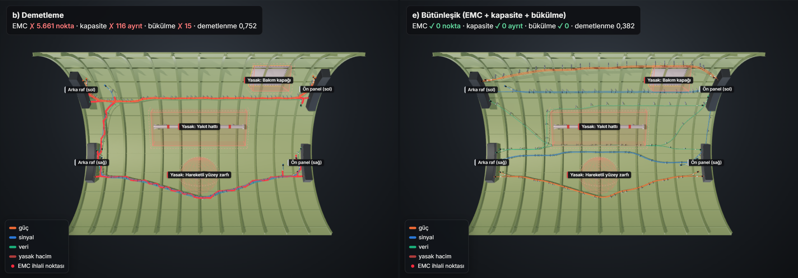

*Looking up into the arch from below the fuselage. Left, bundling: the red dots are the EMC violations found by
the independent check. Right, integrated routing: every check is 0.*

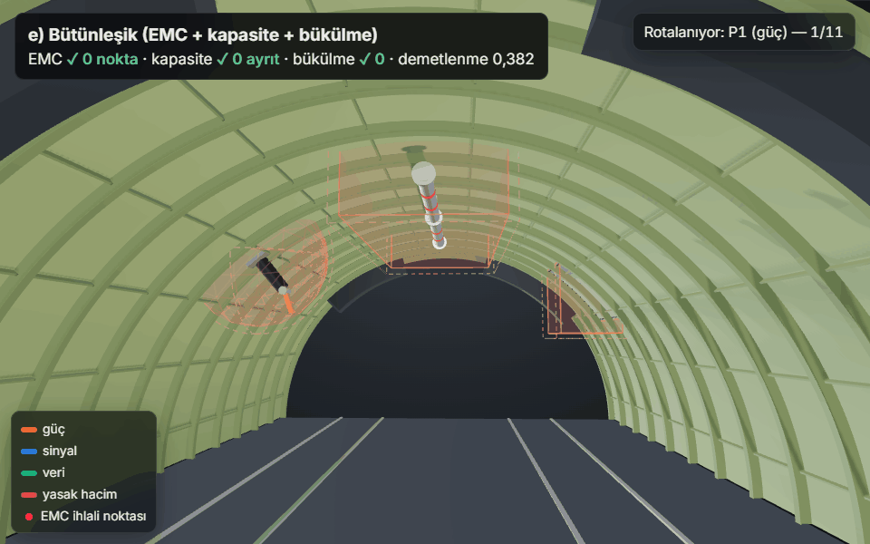

*Integrated method (e): cables are laid one by one in the order the method routed them; clamps appear at the end.*

**Contents:** [Interactive 3D view](#interactive-3d-view) ·
[Introduction](#introduction) · [Problem](#problem) · [Scope](#scope) ·
[Installation and running](#installation-and-running) · [Project structure](#project-structure) ·
[Methods](#methods) · [Independent checks](#independent-checks) · [Results](#results) ·
[Accuracy studies](#accuracy-studies) ·
[Exports](#exports-wirelist-route-file-and-dxf-developed-view) · [Performance](#performance) ·
[All methods](#all-methods) · [How to extend this in the real project](#how-to-extend-this-in-the-real-project) ·
[License](#license)

## Interactive 3D view

A page where you can switch between the 3D views of the six methods with tabs:
**[goktugelbir.github.io/Emc-duyarli-kablo-rotalama](https://goktugelbir.github.io/Emc-duyarli-kablo-rotalama/)**
(local copy: [`docs/index.html`](docs/index.html)).

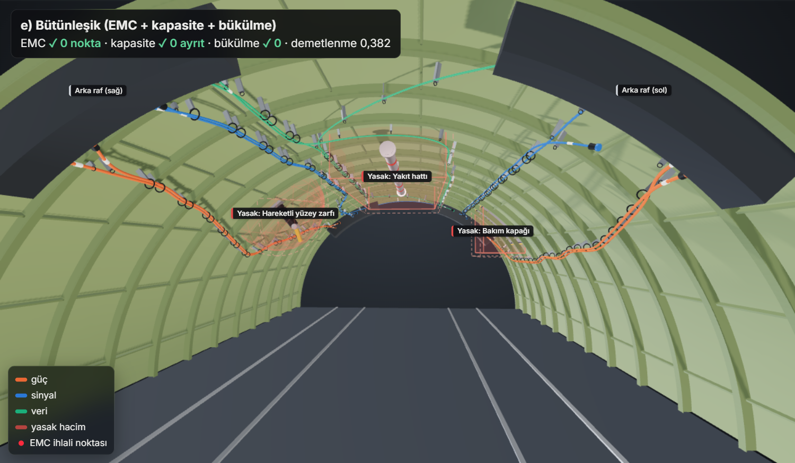

The page is rendered with three.js using physically based materials, environment lighting and shadows:

- fuselage skin with a primer-painted interior and a translucent aluminium exterior; frames, stringers and a floor (seat tracks, floor beams),
- tube-shaped cables whose thickness depends on the class; cables sharing a route are laid side by side inside the bundle,
- clamps and standoff brackets along the bundles, connectors, ID sleeves and equipment racks at the terminals,
- hardware inside the keep-out volumes (a fuel pipe with red bands, a swinging actuator arm, a riveted access
  panel) and their boundaries grown by the clearance (dashed red lines),
- **Play routing:** cables are laid one by one in the order in which the method last routed them (rip-up and
  reroute included); violation points and clamps appear at the end. The page opens with every cable drawn;
  playback starts only with the Play button,
- hovering a cable shows its name, class, route length and **verification margins** (EMC separation margin,
  smallest bend radius, distance to keep-out, `OK`/`CHECK`); clicking it shows the equipment it connects and a
  translucent envelope as wide as the largest separation required to the other classes,
- a one-line summary per method (**✓ all checks clean** or **✗ violations in N checks**, total length, bundling)
  and a collapsible "all metrics" panel; status is never shown by colour alone, always together with ✓/✗,
- a **cable table**: class, route, length, verification margins, near-parallel length and status of every cable of
  the selected method; clicking a row (or pressing Enter) highlights the cable in 3D, so the cable data is also
  readable on touch screens and with the keyboard,
- a **method comparison**: total length (bar), bundling and the failed checks of all six methods in one table; a
  row opens that method,
- **Turkish / English:** the TR | EN control in the header switches every interface text, the number format
  (0,382 / 0.382) and the method names; the first visit follows the browser language, then the choice is remembered.
  The texts live in [`viewer/i18n.json`](harness_demo/viewer/i18n.json); names from the scenario (keep-out volumes,
  equipment) stay as written in the file. The README images are always rendered in Turkish,
- a **guided tour:** on the first visit a short five-step tour points out the methods, the 3D view, the playback,
  the layers and the cable table. It does not lock the page; `Esc` or × closes it and the **?** button in the header
  starts it again,
- a **theme switch** (sun/moon): the dark theme uses a near-black palette; the switch follows the OS setting until it
  is first used, then the choice is remembered in the browser,
- a **fullscreen button** (top right of the 3D view, shortcut `F`, leave with `Esc`); where the browser has no element
  fullscreen (e.g. iPhone Safari) the view fills the window instead,
- a **progress slider** and a segmented speed selector (0.5×–4×) for playback; a segmented control for the camera
  presets (inside, below, outside, top) and toggle chips for the layers (arrow keys work too); an automatically
  widened field of view on narrow screens; the page opens with the outside view and auto-rotate on (off when
  the system asks for reduced motion),
- **shareable links:** the selected method, camera preset and cable are kept in the address bar
  (e.g. `#m=integrated&v=inside&c=S4`); opening the link restores the same view,
- keyboard access: the tabs are navigated with the arrow keys, Home and End (`role="tab"`, `aria-controls`, `tabpanel`),
- overlapping labels are hidden automatically (keep-out volumes first, then equipment, cable names last); labels that
  would leave the view are not shown either.

These realism elements are visual only; cable routes, violation points and metrics come directly from the routing
and the independent checks. The page opens on the integrated method (e).

The page **works fully offline**: three.js and the [Inter](https://rsms.me/inter/) font (variable weight, Latin +
Latin Extended, SIL OFL) are embedded in the page and nothing is loaded from the network. A strict
Content-Security-Policy allows only the page's own inline scripts (by their SHA-256 hashes) and the embedded fonts. Everything written into
the page is HTML-escaped. Nothing is drawn while idle; a frame is rendered only when the camera, the playback, the
pointer or a setting changes.

To enable Pages: in the repository go to **Settings → Pages → Build and deployment → Source: "Deploy from a branch"**,
select branch `main`, folder `/docs`, and save.

## Introduction

This repository is a small, simplified prototype for the problem of **EMC-aware automatic
routing of aircraft wire harnesses on three-dimensional fuselage geometry**. The goal is not to
solve the real problem; it is to show that we understand the problem correctly and that we can
build a testable, modular software skeleton. Every result is therefore measured with checks that
are independent of the routing code, and the code is protected by automated tests and continuous
integration (CI).

## Problem

A fuselage section is given as a triangulated surface model (mesh). Each cable has a start
point, an end point and an EMC class (power / signal / data). The task is to produce surface
routes for all cables such that:

- cables are **bundled** as much as possible (shared routes → fewer supports/clamps, less weight),
- the **separation distance** between cables of different EMC classes is maintained,
- **keep-out volumes** (fuel line, moving-surface envelope, maintenance access panel, etc.) are not entered
  and not approached closer than a **clearance**,
- the **minimum bend radius** and the **maximum number of cables (capacity)** that may pass through a route segment are not exceeded.

These objectives conflict: bundling gathers cables together while EMC wants to keep them apart;
capacity limits how thick a bundle may get, and the bend radius forbids sharp turns.
In the real project the problem will be modelled as a capacitated Steiner forest and solved with
Lagrangian relaxation; this demo addresses a small, simplified version of the same problem with
six methods.

## Scope

**What the demo does**

- Generates a representative fuselage section shaped as a half cylinder with radius 2 m and
  length 6 m as a triangle mesh with ~0.10 m spacing (3904 vertices, 7560 triangles; a small,
  fixed-seed jitter is applied to interior vertices).
- Defines three keep-out volumes (two boxes, one sphere), grows them by a 0.05 m clearance, and removes
  the 429 nodes inside them, as well as the edges crossing the grown volumes, from the graph
  (remaining graph: 3475 nodes, 10033 edges).
- Builds a synthetic scenario of 11 cables (5 + 4 cables run in parallel on the two sides,
  2 cables cross from one side to the other). Neighbouring terminals are of different classes
  and close to each other, but the distance between them is larger than the required separation.
- Runs six routing methods (one of them a branched harness built on Steiner trees) and checks the results with
  five checks that are independent of the routing code.
- Measures how sensitive the sequential methods are to cable order and terminal positions with a
  40-trial **robustness benchmark**.
- Writes the metrics (cable mass included) as a table and exports a wirelist (`wirelist.csv`, with per-cable
  verification margins), all routes as 3D polylines (`routes.json`) and a true-length developed view of the harness
  as DXF for CAD (`harness_developed.dxf`).
- Can also read the skin from an STL/OBJ/PLY file (see "Your own scenario").
- Produces a 3D image per method, a comparison image, a routing animation (GIF), a metrics chart, a Lagrangian
  convergence plot, the interactive 3D page and a run log.

**What the demo does not do**

- There is no clamp spacing constraint (the clamps in the interactive page are visual only).
- No real aircraft data, real CAD geometry or real cable list is used (mesh files can be read, but the
  published results come from the generated half cylinder).
- There is no shielding assignment; EMC is represented only by geometric separation distance.
- The Lagrangian formulation is **simplified** (see below); a Steiner forest structure exists only
  heuristically in method (f) (one Steiner tree per class). The mass is cable mass only (no ties, clamps or
  connectors).
- The bend radius is part of the routing only in methods (e) and (f); the other methods only check it afterwards.
- There is no export to harness exchange formats such as KBL/VEC; the DXF developed view is a starting point for a
  formboard layout and does not re-place the branch points on the plane.
- Cables run on the surface (along mesh vertices); there are no supports standing off the surface.
- The clearance is conservative for boxes: the grown box contains every point closer than 0.05 m to the box
  and excludes slightly more around the corners.

### Representative parameters

All of the values below are **representative**; none are taken from any standard or from a real aircraft.
The fuselage dimensions, keep-out volumes, separations, bend radius, cable diameters and cables are read from the
scenario file ([`harness_demo/examples/fuselage_section.toml`](harness_demo/examples/fuselage_section.toml)); the others are method parameters.

| Parameter | Value |
|:---|---:|
| Separation power–signal | 0.15 m |
| Separation power–data | 0.20 m |
| Separation signal–data | 0.10 m |
| Same class | 0 m |
| Minimum bend radius | 0.10 m |
| Keep-out clearance | 0.05 m |
| Edge capacity K | 2 cables (deliberately tight so the constraint is active) |
| Bundling discount factor | cost of an already used edge × 0.4 |
| EMC penalty | edge length × 20 (additional cost); × 2 in every reroute round |
| Capacity penalty (method e) | edge length × 1000 on a full edge (additional cost) |
| Rip-up-and-reroute rounds | c: at most 5, e: at most 10 |
| Restarts from scratch (method e) | if conflicts remain, up to 3 priority promotions, then the other 3 ordering strategies |
| Cable outer diameter (area mode, bundle bend rule) | power 15 mm, signal 11 mm, data 10 mm |
| Cable mass | power 0.30 kg/m, signal 0.12 kg/m, data 0.08 kg/m |
| Bundle diameter (bundle bend rule) | 1.25 × √(Σ cable diameter²); the rule is off by default |
| Branched harness (method f) | corridor if the class-tree path is at most 25 % longer than the shortest route; corridor edge × 0.3 |
| Randomness | mesh jitter `seed = 42`, robustness benchmark `seed = 7` |

## Installation and running

Python 3.11+ is required. Dependency versions are **pinned** in [`requirements.txt`](requirements.txt):
how shortest-path ties are broken can change between library versions, which changes e.g. the
Lagrangian iteration count. The published outputs were generated with exactly these versions.

```bash
pip install -r requirements.txt
```

```bash
python main.py
```

This command regenerates all outputs: the metrics and robustness tables under `outputs/`, the 3D images
(`routes_*.png`, `comparison.png`, `viewer_inside.png`, `demo.gif`), the 2D charts (`metrics_chart.png`,
`lagrangian_convergence.png`), `wirelist.csv`, `routes.json`, `harness_developed.dxf`, `run_log.txt` and
`docs/index.html`. On our machine the total time is ~30 s: ~11 s robustness benchmark, ~16 s capturing the 3D images, ~2 s 2D charts and
~2 s for mesh, routing, checks and exports. The page contains no timings, so identical results give an identical
page; if it did not change, the 3D capture is skipped (~15 s; `--force-images` forces it). `--no-images` skips the
images altogether (~13 s).

Image export uses a Chrome/Chromium installed on the system (if there is none, it can be downloaded with the
`plotly_get_chrome` command). three.js is embedded in the page, so neither the image export nor viewing
`docs/index.html` needs an internet connection. For the 3D images Chrome is started with its own sandbox and
without extensions; where the sandbox cannot start (e.g. some Linux containers) set `HARNESS_CHROME_NO_SANDBOX=1`.

### Your own scenario

The routing problem lives in a [TOML](https://toml.io) file, not in the code. The example scenario
[`harness_demo/examples/fuselage_section.toml`](harness_demo/examples/fuselage_section.toml) also documents the format in its comments. To try your own data, copy and edit it:

```bash
python main.py --scenario my_scenario.toml
```

| Section | Content |
|:---|:---|
| `[scenario]` | name and short description (optional) |
| `[fuselage]` | fuselage radius and length [m]; mesh density, jitter and seed (optional) — **or** a mesh file (`mesh_file`, `scale`, `max_edge_m`, see below) |
| `[rules]` | minimum bend radius [m]; optional: `capacity_k` (2), `clearance_m` (0.05), the bundle bend rule `bundle_bend_factor` (0 = off) and `bundle_diameter_factor` (1.25) |
| `[routing]` | optional cost weights: `reuse_factor` (0.4), `emc_penalty` (20), `coupling_penalty` (0) |
| `[classes.<class>]` | EMC classes used (`power`, `signal`, `data`), their outer diameters [m] and optional masses `mass_kg_per_m` (for every class or none) |
| `[separation_m]` | minimum distance for every pair of classes [m], e.g. `power-data = 0.20` |
| `[[keep_out]]` | keep-out volumes: box (`lo`, `hi`) or sphere (`center` or `center_on_surface` on the skin, `radius_m`) |
| `[[cables]]` | cables: name, class, both terminals on the skin as `{ x, theta, at }` or as 3D points `{ point = [x, y, z], at }` (`at`: equipment name, optional) |
| `[study]` | cables of the `--exact` comparison (optional) |

The file is checked in full before routing. Missing or unknown fields, wrong types, out-of-range values, undefined
classes, missing class pairs, duplicate cable names and TOML syntax errors are all listed at once with their
location (e.g. `cables[3].from.theta: 0 ile 180 arasında olmalı`, "must be between 0 and 180") and the exit code
is 2. Nothing is written for an invalid file. Console and error messages are in Turkish.

A scenario file may come from someone else, so texts and sizes are limited as well:

- names (cable, equipment, keep-out, scenario) and the description cannot contain control characters, newlines or
  bidi marks; a name has at most 64 characters, the scenario name at most 120, the description at most 1000,
- the file is at most 1 MiB; at most 500 cables and 500 keep-out volumes; `n_axial × n_circ` at most 200,000
  vertices; `[study] exact_cables` at most 6 cables,
- if the keep-out volumes leave no routable edge on the skin, the run stops with a readable message (exit code 2).

`--capacity`, `--clearance`, `--reuse-factor`, `--emc-penalty`, `--coupling-penalty` and `--bundle-bend-factor` on
the command line override the scenario; without them the scenario's value is used, and without that the default
above.

**A real surface (mesh file).** Instead of `radius_m`/`length_m`, `[fuselage]` can name a mesh file:
`mesh_file = "fuselage.stl"` (`.stl`, `.obj` or `.ply`; it must lie in the scenario file's folder or below it, `..`
and absolute paths are rejected; at most 50 MiB and 200,000 vertices). `scale` converts units (`0.001` for a file in
mm), `max_edge_m` subdivides long CAD triangles down to that edge length. In this mode cable terminals and sphere
centres are 3D points (`point = [x, y, z]`, `center = [x, y, z]`); the x axis must be the fuselage axis. An
unreadable or broken file is reported as a scenario error. Two limitations: on a regular, fine triangulation the
bend radius may allow almost no turns (neighbouring directions are 60° apart; `max_edge_m` should not be smaller
than the bend radius; the program warns when the turn graph is too sparse), and `--convergence`, `--exact` and the
DXF developed view only work with the generated half cylinder. The structure (frames, stringers) and camera views of
the 3D page are designed for the half cylinder.

### Command-line options

| Option | Default | Description |
|:---|:---|:---|
| `--scenario FILE` | `harness_demo/examples/fuselage_section.toml` | scenario file (see above) |
| `--no-images` | off | skips PNG/GIF export, no Chrome needed; metrics, robustness table, log and interactive page are still written |
| `--trials N` | 20 | trials per robustness family; `0` skips the benchmark |
| `--out DIR` | `outputs/` | output folder |
| `--docs DIR` | `docs/` | folder of the interactive page |
| `--capacity K` | from the scenario (2) | edge capacity |
| `--clearance M` | from the scenario (0.05) | keep-out clearance [m] |
| `--reuse-factor F` | from the scenario (0.4) | cost multiplier of an already used edge (bundling discount) |
| `--emc-penalty P` | from the scenario (20) | extra cost × length of edges near routes of another class |
| `--coupling-penalty P` | from the scenario (0) | (e) and (f): extra cost × length of edges closer than twice the separation (see below) |
| `--bundle-bend-factor N` | from the scenario (0) | bundle bend rule: turn radius ≥ N × bundle diameter; 0 = off |
| `--order STR` | `input` | cable priority ordering strategy (`input`, `critical-first`, `longest-first`, `shortest-first`) |
| `--workers N` | 4 on Linux, 1 on Windows/macOS | parallel processes for the robustness benchmark; the result does not depend on it |
| `--strict` | off | exit code 1 if method (e) fails a check in the main scenario or the robustness benchmark (used by CI) |
| `--bundle-area-mm2 A` | 0 (off) | capacity becomes a bundle cross-section instead of a cable count; (d), (e), (f) and the capacity check add up cross-sections (see below) |
| `--convergence` | off | also runs the mesh convergence study → `convergence.md` (~5 s); refused before any work if the finest mesh would exceed 200,000 vertices |
| `--exact S` | 0 (off) | compares (e) with the exact MILP solution on a small instance, `S` is the solver time limit → `exact.md`; refused before any work if its mesh would exceed 10,000 vertices |
| `--force-images` | off | recaptures the 3D images even if the page did not change |

Numeric options are range-checked: e.g. `--capacity 0`, `--clearance -1` or `--trials -1` are rejected with a
readable message. Once the terminals are snapped to the graph, the scenario is checked again
(`scenarios.validate_scenario`): a cable whose two
terminals snap to the same node or an unknown EMC class is an error (exit code 2); a terminal moved by more than
0.10 m to reach a routable node, a terminal node shared by different cables and terminals of different classes
closer than their separation are reported as warnings. The published scenario has none of these.

For example, to produce only the metrics and the page in a few seconds:

```bash
python main.py --no-images --trials 0
```

The whole console output is also written to `outputs/run_log.txt` (without local folder paths).

### Tests and continuous integration

```bash
pip install -r requirements-dev.txt
```

```bash
pytest
```

There are 136 tests under [`tests/`](tests) (~60 s; two are optional, see below). Coverage is measured with
`pytest --cov=harness_demo --cov=main`; it is 90 % now and CI fails below 85 %:

- **Checks** (`test_checks.py`): circumradius, resampling, EMC, bend, capacity, keep-out and clearance
  counts on small examples that can be worked out by hand.
- **Geometry and graph** (`test_geometry_graph.py`): the grown volume contains the clearance
  neighbourhood, routable nodes respect the clearance, no edge enters a volume, connectivity, symmetry; the
  vectorised edge lookup ignores direction and rejects non-adjacent nodes; terminals get the right equipment.
- **Routing** (`test_routing.py`): every path is valid (correct terminals, real edges); the baseline
  finds the same lengths as networkx; the turn graph contains no U-turns and no sharp turns; method (e)
  passes every check; rip-up and reroute keeps EMC violations at zero for random orders; in the four orders
  where rerouting gets stuck the restarts make (e) pass every check; the Lagrangian
  lower bound never decreases and never exceeds the upper bound; without a feasible solution the
  Lagrangian fails cleanly instead of producing NaN; the ordering strategies sort correctly and an unknown
  strategy is rejected.
- **Exports** (`test_export.py`): wirelist columns and wire numbers; the verification margins agree with the
  independent checks; `routes.json` is compact, complete and deterministic byte for byte.
- **Robustness benchmark** (`test_benchmark.py`): the terminal perturbation never brings terminals of
  different classes closer than their separation; structure of the summary table; **the parallel run gives the
  same result as the sequential one**; every benchmark router definition works.
- **Viewer** (`test_viewer.py`): the generated page is self-contained (every part inlined); `viewer.js` passes a
  Node.js syntax check (skipped without Node); every `D.<field>` the viewer reads is provided by the data Python
  embeds; every `window.viewer` function `capture.py` calls exists; the Turkish and English dictionaries have the
  same keys and the same `{placeholders}`, and every text key the page uses exists; the Inter font is embedded. An
  optional test opens the page in headless Chrome, goes through the six methods, switches to English and asserts
  that no JavaScript error occurs (needs Chrome, no internet:
  `HARNESS_BROWSER_TESTS=1 pytest`). The embedded three.js bundle is checked against the pinned npm version, and the
  SHA-256 of the bundle and the fonts is pinned in the test. A test also checks that image capture starts Chrome with
  its sandbox, without extensions and without the flags that weaken its security.
- **Regression** (`test_regression.py`): the published metrics table (below) is reproduced exactly.
- **End to end** (`test_cli.py`): `main.py --no-images` writes every file, exports no PNG, the log has no
  local paths, the JSON is valid and the data embedded in the page is consistent; the page has no network
  dependency and the CSP allows every executable script on it by exactly its own hash; invalid options are
  rejected with a message; `--strict` and input errors give the right exit codes.
- **Scenario file** (`test_scenario_file.py`): the example file yields the published scenario exactly; all eleven
  different problems in a broken file are listed with their location; a missing section, a syntax error and a missing
  file; the single sphere centre; `main.py` exits with code 2 and writes nothing for an invalid file.
- **Untrusted text** (`test_untrusted_text.py`): a scenario file may come from someone else. HTML-like names such as
  `<!--<script>` do not break the page (`<`, `>` and `&` are escaped in the embedded JSON), equipment names such as
  `constructor` do not crash the viewer, names starting with `=` or `@` do not run as formulas in the wirelist and
  names are escaped in the markdown report; texts with control characters, newlines or bidi marks, overlong names,
  oversized files, cable lists and meshes are rejected; a keep-out volume covering the whole skin is a clean error.
  The optional browser test opens a page generated with these names and checks that it loads without errors.
- **Dependencies** (`test_dependencies.py`): every version in `requirements.txt` and `requirements-dev.txt` is in
  the CI lock `requirements-ci.lock` at the same version with hashes; the npm dependencies of the viewer bundle are
  pinned exactly and locked with sha512 integrity from the npm registry.
- **Accuracy** (`test_accuracy.py`): **property-based tests** ([hypothesis](https://hypothesis.readthedocs.io/)):
  the exact point-to-polyline distance is compared with very dense sampling on random polylines and is never
  larger than the true distance; the analytic segment–box/sphere intersection is compared with dense sampling.
  Also: the exact distance catches a violation the samples miss; weighted capacity counting; scenario validation
  finds errors and warnings; (e) is clean in area mode; the lower bound holds; near-parallel length; de-duplicated
  violation points; a convergence row; with one cable the MILP optimum equals the shortest bend-feasible path; and
  **(e) is clean in all 40 robustness trials**.
- **New features** (`test_features.py`): `[rules]`/`[routing]` values are read and the command line overrides them;
  the bundle diameter is summed correctly at a shared turn and the bend check uses per-vertex limits; (e) and (f)
  follow the bundle bend rule; the coupling penalty more than halves the side-by-side runs; the mass metric; the area
  mode of the Lagrangian; the class trees of (f) are real trees and the corridors contain no detours; the DXF
  structure, layers and **developed lengths equal to the 3D lengths**; Turkish names are escaped in the DXF;
  end-to-end routing on a skin read from an STL file; mesh files outside the folder, with a wrong extension,
  missing or broken are reported as scenario errors.

Test, lint and type-check settings live in [`pyproject.toml`](pyproject.toml). pytest turns `RuntimeWarning`
into errors, so NaN/infinite steps cannot slip through unnoticed. The code is linted with
[ruff](https://docs.astral.sh/ruff/) (`ruff check .`: pycodestyle, pyflakes, import order, bugbear, pyupgrade,
simplify, ruff) and type-checked with [mypy](https://mypy-lang.org/) (`mypy`; no findings). The checks describe the
keep-out volumes only by their shape through a `Protocol`, so they stay type-safe without importing the geometry
module. The GitHub Actions workflow ([`.github/workflows/ci.yml`](.github/workflows/ci.yml)) runs the lint, the type check,
the tests and a `python main.py --no-images --trials 3 --workers 2 --strict` smoke run (parallel path included; the
job fails if (e) fails a check) with **Python 3.11, 3.12 and 3.13** on every push and pull request. The 3.11 job runs
the tests with coverage and the **viewer tests in headless Chrome** (`HARNESS_BROWSER_TESTS=1`); for that job the
user-namespace restriction of Ubuntu 24.04 is lifted so Chrome's sandbox stays on. The outputs and `coverage.xml`
are kept as an artifact. A separate job runs the pip and npm audits. The supply chain is hardened:

- CI installs packages by hash (`pip install --require-hashes --no-deps -r requirements-ci.lock`). The lock file is generated
  from `requirements-dev.txt` as one file for every Python version and platform:
  `uv pip compile requirements-dev.txt --generate-hashes --universal --python-version 3.11 -o requirements-ci.lock`.
- `pip-audit` scans the lock file for known vulnerabilities on every run. (The first scan found 39 known
  vulnerabilities in pillow 12.3.0; pillow was upgraded to 13.0.0.)
- The npm dependencies of the viewer bundle are installed without running install scripts
  (`npm ci --ignore-scripts`); `npm audit` checks known vulnerabilities and `npm audit signatures` the registry
  signatures.
- Actions are pinned to full commit SHAs instead of tags; checkout does not persist credentials.
- [Dependabot](.github/dependabot.yml) updates the actions, the pip dependencies and the npm dependencies of the
  three.js bundle monthly.

### Technical notes on the images

- **All 3D images in this README are captured from the interactive page itself** (`harness_demo/capture.py`).
  The page is opened in headless Chrome in its capture mode (`docs/index.html?capture`): only the 3D view is
  shown and the page exposes a `window.viewer` interface to select a method, place the camera and set the
  routing progress. Chrome is driven over the DevTools protocol with `choreographer`, the library kaleido uses
  as well. What you see in the README is therefore exactly what the interactive page shows.
- The numbers in the image captions come from the metrics embedded in the page. The red dots are the EMC
  violation points found by `checks.py` themselves (drawn twice as large in capture mode so they stay visible);
  for every method the code verifies with an `assert` that their number equals the value in the table.
- Pillow is used only to place the finished screenshots side by side and to assemble the GIF frames; no
  pixel-level editing is done. In the GIF the camera is fixed and all frames share one palette (the EMC class
  colours are guaranteed to be in it), so the file only stores the regions that change and stays small (~200 KB).
- The metrics chart and the Lagrangian convergence plot are drawn with plotly (`harness_demo/visualize.py`).
- The viewer source lives under [`harness_demo/viewer/`](harness_demo/viewer): the HTML skeleton
  (`template.html`), the styles (`viewer.css`), the viewer code (`viewer.js`) and the embedded three.js bundle
  (`vendor/three.bundle.min.js`, 687 KB). The bundle is built once with esbuild from three@0.169.0, pinned in
  `vendor/package.json`; `package-lock.json` records the sha512 integrity of the npm package. To rebuild it run
  `npm ci --ignore-scripts && npm run build && npm run fonts` in `vendor/` (the last step copies the Inter font to
  `fonts/`). `presentation.py` assembles everything together with the
  data into a single `docs/index.html` and computes the CSP from the hashes of the page's scripts, so the page works
  from GitHub Pages and from the file system, offline.
- Large numeric arrays (mesh vertices and triangles, violation points) are embedded as base64 typed arrays;
  violation points are de-duplicated on a 5 mm grid and stored in millimetres. This brings the embedded data from
  ~350 KB to ~200 KB. The page collects runtime JavaScript errors in `window.__viewerErrors`; the browser test
  asserts that it stays empty.

### Security

The project was audited at source level with
[cloudflare/security-audit-skill](https://github.com/cloudflare/security-audit-skill) and the findings were fixed.
There is no server, account, secret or network request; the attack surface is a scenario file that may come from
someone else. Therefore:

- **Scenario texts are untrusted input** (the limits under "Your own scenario" above); problem messages show odd
  characters escaped, and no fake lines can be written to the console or `run_log.txt`.
- **Page:** `<`, `>` and `&` are written as `\u003c`/`\u003e`/`\u0026` in the embedded JSON, so no name can close a
  script element; the viewer keeps names in a `Map` rather than as plain object keys (names like `constructor` are
  fine); the strict CSP and HTML escaping are described above.
- **Wirelist:** text cells starting with `=`, `+`, `-`, `@`, tab or CR get a leading `'` and do not run as spreadsheet
  formulas. **Markdown reports:** names are backslash-escaped.
- **Image capture:** Chrome runs with its sandbox, without extensions and without the `--disable-web-security`,
  `--allow-file-access-from-files` and `--disable-popup-blocking` flags.
- **Supply chain:** the CI items above; the SHA-256 of the embedded files is pinned in a test.

Each item is covered by a regression test in [`tests/test_untrusted_text.py`](tests/test_untrusted_text.py) and
`test_viewer.py`.

## Project structure

### Architecture

`python main.py` runs the following steps in order (the `run` function in `main.py`):

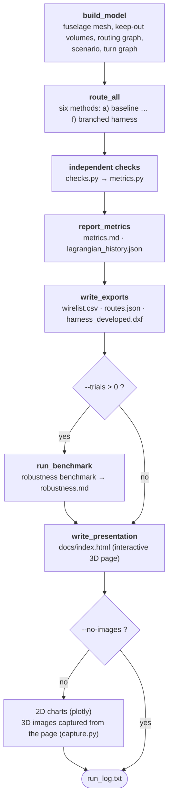

How the modules use each other (arrow: used → user; simplified: the direct use of `geometry`, `graph` and
`scenarios` by later modules is not drawn separately). `checks.py` imports no project module: the checks do not
depend on the routing code they verify. `capture.py` only talks to the page through the browser.

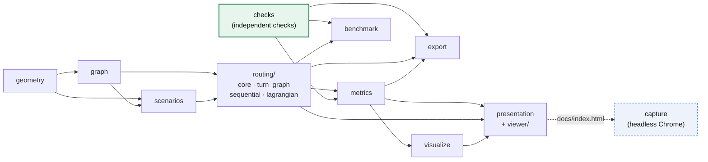

### Files

```
harness_demo/
  geometry.py    # parametric half-cylinder mesh + keep-out volumes (box, sphere), growing by a clearance
  graph.py       # mesh -> routing graph (networkx), keep-out node/edge removal, CSR export
  scenarios.py   # reading and checking scenario files, reading mesh files, snapping terminals to the graph,
                 # terminal perturbation, scenario validation
  examples/      # example scenario: fuselage_section.toml (11 cables, three keep-out volumes, EMC rules)
  routing/       # the 6 routing methods (one public API: from harness_demo.routing import ...)
    core.py        # result type, Dijkstra, route sampling, a) baseline
    turn_graph.py  # bend-aware turn graph
    sequential.py  # b) bundling, c) EMC-aware, e) integrated, f) branched harness; rip-up and reroute,
                   # coupling penalty, bundle bend rule
    lagrangian.py  # d) Lagrangian relaxation
  checks.py      # independent checks (do not use the routing code) and check settings
  metrics.py     # metrics and table formatting
  benchmark.py   # robustness benchmark: random cable order and terminal perturbation (optionally parallel)
  convergence.py # mesh convergence study (1x, 1.5x, 2x mesh)
  exact.py       # exact MILP solution on a small instance (HiGHS, scipy.optimize.milp)
  visualize.py   # 2D charts (plotly): metrics chart, Lagrangian convergence
  presentation.py# interactive page: assembles the viewer and the results into one HTML file
  viewer/        # viewer source: template.html, viewer.css, viewer.js (capture mode included),
                 # i18n.json + i18n.js (Turkish / English interface texts)
    vendor/      # embedded three.js bundle, the Inter font (fonts/) and the pinned npm setup that produces them
  capture.py     # captures the README 3D images from the page with headless Chrome (PNG + GIF)
  export.py      # wirelist (wirelist.csv, with verification margins) and 3D routes (routes.json)
  dxf.py         # true-length developed view of the harness (harness_developed.dxf, DXF R12, mm)
main.py          # end-to-end run: build_model -> route_all -> report_metrics -> write_exports
                 #   -> run_benchmark -> write_presentation; command-line options
tests/           # pytest tests (136 tests; two are optional browser tests)
outputs/         # 3D images (PNG, GIF), 2D charts, wirelist.csv, routes.json, harness_developed.dxf,
                 # metrics.md, robustness.md, convergence.md, exact.md, lagrangian_history.json, run_log.txt
docs/index.html  # single-page interactive 3D view for GitHub Pages
.github/workflows/ci.yml   # 3.11/3.12/3.13 matrix: hashed install + lint + type check + tests (coverage, browser)
                           #   + --strict smoke run; pip-audit + npm audit in a separate job
.github/dependabot.yml     # action, pip and npm updates
pyproject.toml   # pytest, coverage, ruff and mypy settings
LICENSE          # MIT license (embedded three.js: MIT, Inter: OFL)
requirements.txt / requirements-dev.txt   # pinned versions (development: pytest, pytest-cov, ruff, mypy, hypothesis,
                                          #   pip-audit)
requirements-ci.lock       # fully hash-pinned lock file for CI, covering every Python version
```

## Methods

**a) Baseline.** Independent Dijkstra for each cable on the graph with edge weight = Euclidean length.

**b) Bundling.** Cables are routed in scenario order; the cost of every edge used by another
cable is reduced by a factor of 0.4. Later cables thus join existing routes.

**c) EMC-aware bundling.** In addition to (b), the nodes within `separation distance + 0.03 m`
of a cable's route are marked as "risky" for the other EMC classes. This neighbourhood is computed
only around the route with `scipy.spatial.cKDTree.query_ball_point`. A cable of a different class
pays an extra penalty on edges touching a risky node. The penalty is soft: it can be violated if
necessary, but it is expensive.

Sequential routing depends on the cable order: a cable only "sees" the cables routed before it.
The first pass is therefore followed by **rip-up and reroute**. Using its own conflict measure (sample
points closer than the separation and, if applicable, edges over capacity), the router finds the
conflicting cables. It rips them up and reroutes them one by one, most conflicting first, now seeing
**all** other cables, with the EMC penalty doubled in every round. It stops when no conflict is left
or the round limit is reached. The best solution seen is returned, so rerouting can never make the
result worse. (The router's conflict measure only decides what to reroute; the reported metrics come
from the independent checks.)

**d) Simplified Lagrangian relaxation.** The model solved is:

```
min  Σ_k length(P_k)                     (P_k: path of cable k)
s.t. load_e = Σ_{k : e ∈ P_k} l_k ≤ K    for every edge e
```

l_k is the load of the cable: 1 (cable count) or, in area mode, its cross-section (K = bundle area).
The capacity constraint is moved into the objective with multipliers λ_e ≥ 0:

```
L(λ) = Σ_k SP_k(w + l_k · λ) − K · Σ_e λ_e
```

The problem thus decomposes into an independent shortest-path subproblem per cable, and L(λ)
is a **lower bound** on the optimum for every λ. λ is updated by projected subgradient
(`g_e = load_e − K`) with a Polyak step size. In every iteration, a repair heuristic that routes
sequentially with `w + λ` costs while closing edges whose capacity is full produces a feasible
solution, i.e. an **upper bound**. The lower and upper bounds are recorded at every iteration.

The Polyak step targets the best upper bound. While no feasible solution has been found (the upper
bound is infinite), the target is the best lower bound raised by 5 %, so the step is always finite.
(In the previous version the step became infinite in that case and the multipliers turned into NaN; a
test now guards this case.) Unknown bounds are written as `null` to `lagrangian_history.json`.

> This is a **simplified** version of the formulation in the real project: here the objective
> is only the total cable length, and bundling (paying for a shared edge once) is not in the
> model. In the real project the objective will include the capacitated Steiner forest
> structure, EMC constraints and node selection costs.

**e) Integrated method (EMC + capacity + bend).** The bundling, EMC penalty and rip-up-and-reroute
logic of (c) run on a bend-aware **turn graph**:

- **The bend radius is a hard constraint.** Each state of the turn graph is a directed edge (u→v); a
  transition (u→v)→(v→w) exists only if w ≠ u and the radius of the circle through u, v, w is not smaller
  than the minimum bend radius. This is exactly the condition the independent bend check tests, so every
  path found has zero bend violations by construction. In this scenario 53 % of the 109,924 possible turns
  (such as 90° turns) are removed and 51,544 remain. The cost of a state is paid when its edge is entered.
  A virtual source connects to every edge leaving the start node and every edge reaching the end node
  connects to a virtual sink, so there is no turn constraint at the terminals (connector).
- **Capacity** is practically hard: a full edge (already carrying K other cables) costs 1000 times its
  length extra. If the geometry leaves no other choice, routing does not fail; the violation is reported.
- **EMC and bundling** are as in (c). Rip-up and reroute also takes capacity conflicts into account and
  runs for at most 10 rounds.
- **Restarts from scratch.** Rerouting cables one at a time gets stuck for some orders: the same routes
  come back every round, or the growing EMC penalty only trades the EMC conflict for a capacity one
  (with the tight K = 2, the lane a cable needs to go around the end of another bundle is full). If
  conflicts remain when the round limit is reached, the whole pass is repeated from scratch with the
  **conflicting cables routed first** (priority promotion, up to 3 times). If conflicts still remain, it
  is tried once more from each of the other three ordering strategies. The search stops at the first
  conflict-free solution, so a solution that is already conflict-free (the main scenario included) is never
  touched. `restarts=0` disables this step.
- **Two more optional rules** (see "Bundle bend rule and coupling penalty"): a bend radius that grows with the
  bundle (a cost per turn) and a penalty on the length routes of different classes run side by side.

**f) Branched harness (Steiner tree).** A real harness is not a set of point-to-point cables but a branching tree:
trunks split into branches towards the equipment. (f) first builds, for every EMC class, a **Steiner tree** that
connects all terminals of that class (Mehlhorn's 2-approximation, networkx). The trees are built in turn (power,
signal, data); edges closer than the separation to the trees of the previous classes pay the EMC penalty, so the
trunks of the classes stay apart. Each cable's path through its tree then becomes the cable's **corridor**, whose
edges cost 0.3 × length; the cables are routed as in (e) (bend as a hard constraint, capacity, EMC, rip-up and
reroute, restarts). So the cables gather on the shared trunk and leave it only where a branch, the bend radius,
capacity or EMC separation requires. A cable whose tree path is more than 25 % longer than its shortest route (e.g.
because the class tree joins the right and the left side) gets no corridor. Without this rule the first version had
the cables travel along the tree and the total length grew to 83 m.

## Independent checks

`checks.py` does not use the routing module or the graph; it takes only the node lists and
vertex coordinates and recomputes everything from geometry:

- **EMC violation:** Routes are resampled at 0.05 m spacing. A sample point closer than the
  required separation to a route of a different class counts as a violation (once per
  offending route). Unit: points. The distance is measured **exactly to the other route's segments**, not only to
  its samples: the nearest sample can be up to 2.5 cm further away than the true nearest point and could miss a
  shallow violation near the threshold (up to ~3 mm for a 0.10 m pair). The exact computation is only done for
  points that close to the threshold. This change found 7 missed violation points for the baseline, 1 for bundling
  and 8 for the Lagrangian solution; (c) and (e) are still 0.
- **Bend:** Violation if the radius of the circle through three consecutive vertices is smaller
  than 0.10 m (an approximate criterion).
- **Keep-out volume:** Violation if one of the sample points at 0.05 m spacing lies inside a box/sphere.
- **Clearance:** Violation if a sample point is outside a volume but closer than 0.05 m to it. The
  distance is computed exactly from the volume's raw parameters (Euclidean distance to the box, distance
  to the sphere surface). To show that the check actually works, `main.py` also routes the baseline on a
  graph built **without** the clearance: that produces 69 clearance violation points.
- **Capacity:** Number of edges carrying more than K cables (area mode: edges whose total cable cross-section
  exceeds the bundle area).

When the graph is built, whether an edge cuts a keep-out volume is now found **analytically** (slab method for
boxes, segment-to-centre distance for spheres) instead of looking at 5 interior points of the edge. In this scenario
the result is the same (no additional edge between routable nodes is removed), but the test no longer depends on
sampling.

## Results

Output of `python main.py` (same as `outputs/metrics.md`):

| Method | Total length [m] | Unique length [m] | Bundling ratio | Cable mass [kg] | EMC violation [points] | Bend violation | Keep-out violation | Clearance violation [points] | Capacity violation [edges] | Time [s] |
|:---|---:|---:|---:|---:|---:|---:|---:|---:|---:|---:|
| a) Baseline (independent Dijkstra) | 61.66 | 51.65 | 0.162 | 10.84 | 987 | 0 | 0 | 0 | 20 | 0.00 |
| b) Bundling | 71.84 | 17.80 | 0.752 | 12.37 | 5661 | 15 | 0 | 0 | 116 | 0.01 |
| c) EMC-aware bundling | 66.18 | 35.22 | 0.468 | 11.39 | 0 | 8 | 0 | 0 | 35 | 0.02 |
| d) Lagrangian relaxation (K=2) | 61.76 | 53.80 | 0.129 | 10.85 | 895 | 0 | 0 | 0 | 0 | 0.68 |
| e) Integrated (EMC + capacity + bend) | 66.05 | 40.80 | 0.382 | 11.32 | 0 | 0 | 0 | 0 | 0 | 0.04 |
| f) Branched harness (Steiner tree) | 66.50 | 40.47 | 0.391 | 11.48 | 0 | 0 | 0 | 0 | 0 | 0.17 |

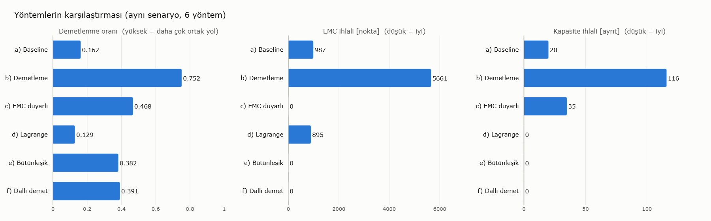

Lagrangian: 60 iterations (iteration limit); lower bound 61.7624 m, upper bound 61.7639 m, gap 0.0014 m (0.002 %).
**Optimality gap of (e):** every solution of (e) satisfies the bend and capacity constraints, so two lower bounds
hold: the sum of the shortest bend-feasible routes (61.66 m) and the Lagrangian lower bound of the
capacity-constrained problem (61.76 m). With the larger one, the total length of (e) (66.05 m) is **at most 6.5 %**
above the shortest solution meeting these constraints. (EMC separation is not in the bounds, so the true gap is
smaller.)
Bundling ratio = 1 − unique length / total length. Cable mass = Σ length × kg/m of the class (without ties
and clamps). Times are routing time only (excluding checks and plotting) and vary by machine.

### Discussion

- **Baseline** gives the shortest total length but bundles the cables hardly at all (0.162).
  Even so there are 987 EMC violation points: the shortest paths leaving neighbouring terminals
  approach each other at the edges of the keep-out volumes. A "shortest path only" approach
  without EMC awareness is therefore not sufficient.
- **Bundling** reduces the unique route length from 51.7 m to 17.8 m (ratio 0.752). The price is
  a ~17 % increase in total cable length and a large increase in EMC violations (5661 points),
  because cables of different classes share the same edges. Capacity violations (116 edges) and bend
  violations (15) are also the highest.
- **EMC-aware bundling** reduces EMC violations to zero in this scenario while keeping the
  bundling ratio at 0.468: cables are bundled within a class, and separate routes form between
  classes. It does not, however, respect capacity (35 edges) or the bend radius (8).
- The **Lagrangian** method removes the baseline's 20 capacity violations with only 0.11 m (0.17 %)
  of extra length. The gap between the lower and upper bound is 0.0014 m (0.002 %), i.e. the solution
  found is at most 1.4 mm from the optimum of this simplified model on this graph. Since the model has
  no EMC or bundling, EMC violations are at the baseline level.
- The **integrated method** is the first method that satisfies all five checks at once: EMC, bend,
  keep-out, clearance and capacity violations are all 0. Its total length (66.05 m) is even slightly
  shorter than that of (c). Its bundling ratio (0.382) is lower than that of (c), because K = 2 allows at
  most two cables per edge; this is the natural price of the deliberately tight capacity.
- The **branched harness** also satisfies all five checks. In this scenario it is 0.45 m (0.7 %) longer than (e)
  with a 0.33 m shorter unique length (bundling 0.391): K = 2 allows at most two cables on a trunk, which limits what
  a tree structure can gain. With a realistic capacity (area mode) the two methods are close as well (see below).
  The value of (f) is that it proposes one trunk-and-branch structure per class instead of separate routes per cable.
- No method produced a keep-out or clearance violation; since the nodes inside the grown volumes and the
  edges crossing them are removed from the graph, this is the expected result and has been confirmed by
  the independent checks.

### Robustness benchmark: does the result depend on the cable order?

With sequential methods a single "0 violations" result can be luck. `benchmark.py` measures this with
two families of trials (20 trials each, `seed = 7`). **Random order:** the original scenario with the
cables routed in a random order. **Terminal perturbation:** in addition, every terminal is shifted by up
to ±0.05 m axially and ±1.5° around the arc. These bounds are small enough never to bring terminals of
different classes closer than their separation (a test checks this). Every trial is measured with the
independent checks (`outputs/robustness.md`; the table is generated with Turkish labels — "Rastgele sıra"
= random order, "uç nokta sapması" = terminal perturbation, "tek geçiş" = single pass, "söküp yeniden
rotalama" = rip-up and reroute):

| Family | Method | EMC violations = 0 | EMC mean / max [points] | Capacity mean / max [edges] | Bend max | All checks clean |
|:---|:---|---:|---:|---:|---:|---:|
| Random order | c) single pass | 6/20 | 24.1 / 72 | 59.1 / 116 | 13 | 0/20 |
| Random order | c) + rip-up and reroute | 20/20 | 0.0 / 0 | 70.7 / 116 | 18 | 0/20 |
| Random order | e) Integrated | 20/20 | 0.0 / 0 | 0.0 / 0 | 0 | 20/20 |
| Random order | f) Branched harness | 20/20 | 0.0 / 0 | 0.0 / 0 | 0 | 20/20 |
| Random order + terminal perturbation | c) single pass | 7/20 | 16.0 / 56 | 57.5 / 108 | 10 | 0/20 |
| Random order + terminal perturbation | c) + rip-up and reroute | 20/20 | 0.0 / 0 | 52.4 / 110 | 16 | 0/20 |
| Random order + terminal perturbation | e) Integrated | 20/20 | 0.0 / 0 | 0.0 / 0 | 0 | 20/20 |
| Random order + terminal perturbation | f) Branched harness | 20/20 | 0.0 / 0 | 0.0 / 0 | 0 | 20/20 |

- Without rip-up and reroute, (c) is EMC-clean in only 13 of 40 trials, so the "0 violations" result in
  the original scenario was partly a matter of order. With rip-up and reroute it is EMC-clean in all 40.
- (c) does not respect capacity or bend radius in any order, so it never passes all checks.
- (e) and (f) pass all five checks in 40 of 40 trials. Without the restarts (`restarts=0`) it is 36: in the
  remaining 4 trials (all with the original terminals in a random order) up to 10 EMC violation points
  remained. In two of them S4 crosses D2; in the other two a power cable comes within 0.129 m and
  0.148 m (0.15 m required) of signal cables near the terminals. These orders are kept as a regression
  test in `test_routing.py`.
- To see that the result is not tuned to these 40 trials, the same two families were also run with five
  different seeds (7, 1, 99, 123, 2024) and 100 trials per family: with restarts (e) passes all checks in
  **1000 of 1000** trials, without them in 954. Since the penalty is soft this is not a guarantee, but no
  remaining failure was found in this scenario under these perturbations.

### Cable ordering strategies (`--order`)

`--order` selects the order of the first pass of the sequential methods (b, c, e): `input` (scenario order,
default), `critical-first` (power, then data, then signal; longest cable first within a class), `longest-first`
and `shortest-first` (by the straight distance between the terminals). Measured with the independent checks in
this scenario:

| Strategy | c) EMC / capacity / bend | c) total length | e) EMC / capacity / bend | e) total length |
|:---|:---:|---:|:---:|---:|
| `input` | 0 / 35 / 8 | 66.18 m | 0 / 0 / 0 | 66.05 m |
| `critical-first` | 0 / 93 / 9 | 72.07 m | 0 / 0 / 0 | 72.00 m |
| `longest-first` | 0 / 93 / 9 | 72.07 m | 0 / 0 / 0 | 72.00 m |
| `shortest-first` | 0 / 110 / 9 | 79.46 m | 0 / 0 / 0 | 76.73 m |

The integrated method passes every check with every strategy, but in this scenario no strategy beats the default
order: cables get 6–11 m longer and the capacity violations of (c) increase. (`critical-first` and
`longest-first` produce different orders but reach the same solution for c) and e) after rip-up and reroute.)
What really reduces the order dependence is rip-up and reroute, as the robustness benchmark above shows; the
strategies are an option for experiments.

## Accuracy studies

### Mesh convergence: do the results depend on the 0.1 m mesh?

The separations (0.10–0.20 m) are only one or two mesh edges long. `python main.py --convergence` refines the mesh
1.5 and 2 times in both directions with the same geometry, keep-out volumes, terminals and parameters, and reruns the
baseline and the integrated method ([`outputs/convergence.md`](outputs/convergence.md)):

| Mesh | Edge spacing [m] | Nodes | a) length [m] | a) EMC [points] | e) length [m] | e) / bend bound | e) EMC / capacity / bend / keep-out / clearance | e) time [s] |
|:---|---:|---:|---:|---:|---:|---:|:---:|---:|
| 1× | 0.100 | 3475 | 61.66 | 987 | 66.05 | 1.071 | 0 / 0 / 0 / 0 / 0 | 0.05 |
| 1.5× | 0.067 | 7694 | 61.22 | 734 | 65.80 | 1.074 | 0 / 0 / 0 / 0 / 0 | 0.14 |
| 2× | 0.050 | 13622 | 61.29 | 742 | 85.89 | 1.370 | 0 / 0 / 0 / 0 / 0 | 3.12 |

- **(e) passes all five checks on every mesh.** On the 1× and 1.5× meshes the total length agrees within 0.4 %; in
  this range the main result does not depend on the mesh.
- **On the 2× mesh (e) finds 30 % longer routes.** The root cause is that the bend criterion depends on the mesh.
  For a corner that turns by φ between edges of length L, the circle through three consecutive vertices has the
  radius R = L / (2·sin(φ/2)). A 45° kink gives R = 0.131 m on 0.1 m edges and passes, but R = 0.065 m on 0.05 m
  edges and fails. The coarse mesh therefore tolerates sharp kinks. On the fine mesh the cross-link cable S4 can no
  longer turn into the narrow strip at the forward end and stays clean with a long detour. This is a limitation of
  the criterion itself: a more accurate model would measure bending over a fixed arc length (e.g. the turning angle
  within a 0.1 m window).
- The study also led to an improvement of the restart step: it used to take the **first** clean candidate, which on
  the 2× mesh contained a 17.7 m detour for S2. Now all candidates are tried and the shortest clean one is chosen.

### Comparison with the exact solution (small instance)

The sequential methods are heuristics. `python main.py --exact 120` compares (e) with an exact mixed-integer model
(MILP) of the same problem ([`harness_demo/exact.py`](harness_demo/exact.py), [`outputs/exact.md`](outputs/exact.md)).
Model: minimise total length; each cable is a flow on the turn graph (bend is a hard constraint); load ≤ K on every
edge; two cables of different classes cannot both use two edges closer than their separation (EMC). The solver is
HiGHS, shipped with SciPy, so there is no new dependency. The full instance (11 cables) is far too large, so the
instance is the 0.2 m mesh with the hardest pair, S4 + D2 (the cables that crossed in two of the stuck robustness
orders):

| Solution | Total length [m] | Checks (EMC / capacity / bend / keep-out / clearance) | Time [s] |
|:---|---:|:---:|---:|
| e) Integrated | 12.456 | 0 / 0 / 0 / 0 / 0 | 0.01 |
| MILP best solution (time limit reached) | 11.854 | 0 / 0 / 0 / 0 / 0 | 120.8 |

The proven lower bound is 11.47 m: (e) is **at most 7.9 %** above the optimum and 4.8 % longer than the solution the
MILP found. The solver could not prove optimality in 120 s nor in 300 s (gap 3.2 %); with 4 cables on the 0.2 m mesh
it found no feasible solution at all within 60 s. The exact model is therefore only a reference for small instances;
the practical value of (e) is that it delivers a solution of nearly the same quality in 10 ms.

### Cross-section based capacity

By default capacity is a number of cables per edge (K = 2). In reality the limit is the bundle cross-section: more
thin cables fit into the same clamp. With `--bundle-area-mm2 A`, methods (d), (e), (f) and the capacity check add
up the cable cross-sections (diameters: power 15 mm, signal 11 mm, data 10 mm), which may not exceed `A`. In the
Lagrangian relaxation each cable's subproblem uses the cost `w + l_k · λ` (l_k: cross-section). For example
`A = 360 mm²` (two power cables) lets three signal or data cables share a bundle: (e) still passes every check and
the bundling ratio rises from 0.382 to 0.458 (total length 65.77 m); (f) is clean at 66.35 m and 0.446; (d) meets the
area capacity at 61.74 m (it ignores EMC). The robustness trials are clean in this mode as well.

### Bundle bend rule and coupling penalty

Two realism rules are optional and off by default, so the published results above do not change.

**Bundle bend rule** (`--bundle-bend-factor N` or `rules.bundle_bend_factor`). The real rule is usually "minimum bend
radius = n × bundle diameter"; a thick bundle cannot turn as sharply as a thin cable. The cables that bend together
at a turn (a–v–c) are the ones whose paths contain the same turn (in either direction); their bundle diameter is
`1.25 × √Σd²`. The check compares every vertex with its own limit, `max(minimum radius, N × bundle diameter)`. In
(e) and (f) the rule is a **cost per turn** in the turn graph: a turn at which adding this cable would make the
bundle too thick pays 1000 × length like a full edge, and rip-up and reroute counts these conflicts as well. With
`N = 6` (a bundle of two power cables needs 0.16 m):

| Method | Total length | Bend violations (rule off → `N = 6`) | Other checks |
|:---|---:|---:|:---|
| b) Bundling | 71.84 m | 15 → 144 | unchanged |
| c) EMC-aware | 66.18 m | 8 → 20 | unchanged |
| e) Integrated | 66.05 → 66.09 m | 0 → 0 | all 0 |
| f) Branched harness | 66.50 → 66.45 m | 0 → 0 | all 0 |

The `bend_limit_m` column of the wirelist gives the largest required radius along the cable's route. The MILP
reference does not include this rule.

**Coupling penalty** (`--coupling-penalty P` or `routing.coupling_penalty`). The EMC check only looks at the
minimum distance, while coupling grows with the length two cables run side by side. In (e) and (f) this penalty adds
`P × length` to edges closer than twice the separation to a route of another class. "Side-by-side run" is the total
length over which cables run that close to foreign routes (sum of `near_parallel_length_m`). In the main scenario:

| P | (e) length | (e) side-by-side | (e) smallest EMC margin | (f) length | (f) side-by-side |
|---:|---:|---:|---:|---:|---:|
| 0 (default) | 66.05 m | 9.28 m | +3.9 cm | 66.50 m | 14.80 m |
| 0.5 | 65.82 m | 0.25 m | +9.9 cm | 66.43 m | 7.04 m |
| 1 | 65.82 m | 0.25 m | +9.9 cm | 69.84 m | 3.56 m |
| 2 | 65.82 m | 0.25 m | +9.9 cm | 69.92 m | 3.29 m |
| 5 | 66.32 m | 0.59 m | +4.0 cm | 73.57 m | 0.87 m |

In every row all five checks are 0 and (e) and (f) are clean in 40 of 40 robustness trials. In the main scenario every
value between 0.5 and 2 improves all metrics of (e); in (f) the penalty shortens the side-by-side runs but lengthens
the cables. **In other situations, however, the penalty lengthens the cables of (e)** (P = 1, checks still clean):

| Situation | P = 0 | P = 1 |
|:---|---:|---:|
| Exact instance (S4 + D2, 0.2 m mesh) | 12.46 m (at most 7.9 % from optimal) | 12.69 m (at most 9.6 %) |
| Mesh refined 2× | 85.89 m | 97.07 m |
| `--order critical-first` | 72.00 m | 78.77 m |
| `--order longest-first` | 72.00 m | 73.15 m |
| `--order shortest-first` | 76.73 m | 77.60 m |
| `--bundle-area-mm2 360` | 65.77 m | 65.59 m |

The penalty is therefore off by default; for a study where side-by-side runs matter it can be turned on with
`--coupling-penalty 1`.

## Exports: wirelist, route file and DXF developed view

`python main.py` also writes three machine-readable files ([`harness_demo/export.py`](harness_demo/export.py),
[`harness_demo/dxf.py`](harness_demo/dxf.py)).

**[`outputs/wirelist.csv`](outputs/wirelist.csv): the wirelist.** One row per cable of the integrated method (e).
Like a production wirelist it lists terminals and length; in addition it recomputes each cable's own
verification margins from geometry with the building blocks of the independent checks:

| Column | Meaning |
|:---|:---|
| `wire_id`, `cable_name`, `emc_class` | wire number (W01…), name, EMC class |
| `from_location`, `to_location` | equipment it connects, e.g. `Arka raf (sağ)` (aft rack, right) → `Ön panel (sol)` (forward panel, left) |
| `from_node`, `from_x_m` … `to_z_m` | terminal nodes and their coordinates [m] |
| `length_m`, `mass_kg`, `waypoint_count` | route length, cable mass (if the scenario gives masses) and number of points |
| `bundled_with`, `shared_length_m`, `sharing_ratio` | cables it shares its route with, shared length and ratio |
| `min_emc_margin_m` | distance to the nearest cable of another class − required separation; < 0 = EMC violation |
| `min_bend_radius_m`, `bend_limit_m` | smallest three-point circumradius along the route and the largest required radius (0.10 m with the rule off); a vertex whose radius is below its own limit is a bend violation |
| `min_keepout_distance_m` | smallest distance to a keep-out volume; < 0.05 m = clearance violation |
| `near_parallel_length_m` | route length closer than twice the required separation to a cable of another class (informative, not a violation) |
| `status` | `OK` if every margin holds, otherwise `CHECK` |

In this scenario all 11 cables are `OK`. Sample rows:

| Cable | From → to | Length | Bundle | EMC margin | Min. R | To keep-out | Status |
|:---|:---|---:|:---|---:|---:|---:|:---:|
| W01 P1 (power) | aft rack (right) → fwd panel (right) | 5.82 m | P2 | +13.1 cm | 0.122 m | 9.3 cm | OK |
| W05 D1 (data) | aft rack (right) → fwd panel (right) | 5.53 m | D2, D3 | +3.9 cm | 0.142 m | 7.7 cm | OK |
| W10 D3 (data) | aft rack (right) → fwd panel (left) | 6.33 m | D1 | +8.7 cm | 0.112 m | 8.1 cm | OK |
| W11 S4 (signal) | aft rack (left) → fwd panel (right) | 7.86 m | S2, S3 | +3.9 cm | 0.119 m | 8.9 cm | OK |

The tightest EMC margin is +3.9 cm (between D1 and S4). A test ties the margins to the independent checks: in
the integrated solution all cables are `OK`, and in the bundling solution exactly the cables with a negative EMC
margin are marked `CHECK`. The same margins are shown in the tooltip and the cable table of the 3D page.

`near_parallel_length_m` addresses a gap in the EMC model: the check only looks at the minimum distance, while in
reality coupling grows with the length two cables run side by side. The column makes cables visible that keep their
separation but run close to the limit over a long distance. Distances are measured exactly, as in the EMC check.

**[`outputs/routes.json`](outputs/routes.json): all routes.** Every cable of all six methods, for CAD/ECAD import
or further analysis. Per cable: `waypoints_xyz` (3D polyline through mesh vertices on the fuselage skin,
metres), `node_ids`, terminal equipment, length and bundle data; per method: the routing order and the check
results; plus the run parameters (capacity, bend radius, clearance, separation table, ordering strategy), units
and coordinate frame. The points are the raw routes the checks evaluate; the lifted, smoothed look of the 3D page
is visual only and is not in the file.

The file is compact and deterministic: every array is on one line (~850 lines, ~130 KB; the previous version was
~20,000 lines, ~395 KB) and it contains no run-dependent value such as timings. The same inputs reproduce it byte
for byte (a test checks this), so git only shows real changes.

**[`outputs/harness_developed.dxf`](outputs/harness_developed.dxf): developed view.** A cylinder is developable:
`(x, θ) → (x, R·θ)` preserves every length on the skin. Since the routes run on the skin, this drawing shows every
cable of (e) at its **true length** (P1: 5.8204 m in 3D, 5.8205 m in the drawing); it is a starting point for a
formboard / nailboard layout. Units are millimetres; layers: `OUTLINE` (the developed section), `KEEPOUT` (footprint
of the keep-out volumes on the skin), `POWER`, `SIGNAL`, `DATA` (one polyline per cable), `TERMINALS` and `LABELS`
(cable names). The format is DXF R12, the most widely readable version; non-ASCII characters are written as escapes
such as `\U+00FC`. The file was read with an independent reader (ezdxf) without errors. With a mesh file the
surface cannot be developed, so no DXF is written.

## Performance

The computational core was sped up after profiling. Results are **bit-identical**: on top of the regression tests,
the sampling functions and every route of all five methods were compared against the previous version.

- Route sampling (`routing.densify`, `checks.resample_polyline`) and the bend check use vector operations
  instead of Python loops; numpy's `linspace` arithmetic is reproduced exactly. (The two sampling functions are
  separate on purpose: the checks must not depend on the routing code they verify.)
- The route geometry that sequential routing recomputes for every cable and every reroute round (unique edges,
  samples, KD-trees, nearby nodes) is cached by the route itself.
- Edge lookup is vectorised with `searchsorted` on sorted keys instead of a dictionary.
- The headless browser for the 2D charts only starts when the charts are drawn, so it never affects the reported
  routing times.
- The sparse-matrix structure of the turn graph is built once; each call only fills in the weights. Arcs that do not
  apply to the cable get an infinite weight, which Dijkstra never relaxes.
- When a cable is rerouted, its old route is still feasible under the new costs; its cost is passed to Dijkstra as an
  upper bound (`limit`), so the search stops beyond it. The path found does not change.
- Pairwise results of the conflict score are cached, so route pairs that did not change between rounds are not
  recomputed. These three changes brought the robustness benchmark from ~11.6 s to ~10.2 s; every route and metric
  stayed the same.
- The 3D page no longer draws while idle (before ~60 frames per second, now 1 frame in 2 seconds measured). The
  images are only recaptured when the page changes.

| | Before | After |
|:---|---:|---:|
| Robustness benchmark (40 trials × 3 methods) | 28–41 s | 9–18 s |
| `python main.py --no-images` | 30–45 s | 10–21 s |
| `python main.py` (all outputs, images included) | ~65 s | ~30 s (~15 s if the images are up to date) |

The measurements are consecutive runs on the same laptop; absolute times vary with the machine's load, but the
speed-up is 2–3× in every comparison.

**Parallel robustness benchmark.** The trials are independent, so `--workers N` runs them in separate processes.
The trials are drawn in the parent process, so the result does not depend on the number of workers (a test checks
this). The gain depends on the platform, though. On Windows (and macOS) processes start with `spawn` and every worker
re-imports numpy, scipy, networkx and trimesh (~1.5–2 s per worker), which eats most of the gain of a ~10 s
benchmark: on this machine 10.2 s sequential vs. 8.8 s with 4 workers. Threads only gave ~1.3× because of the GIL
and are not used. The default is therefore 1 on Windows/macOS and 4 on Linux, where processes fork cheaply. The Linux
speed-up could not be measured on this machine; CI runs the parallel path on Linux for correctness.

Most of the remaining time is spent in scipy's Dijkstra (~0.5 ms per call) and in capturing the images.

## All methods

| a) Baseline | b) Bundling |
|:---:|:---:|
|  | 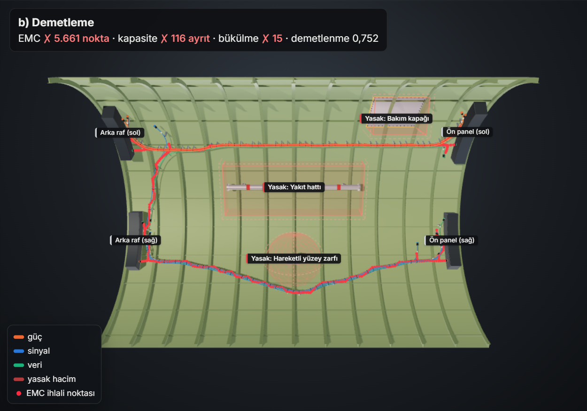 |
| **c) EMC-aware bundling** | **d) Lagrangian relaxation** |
| 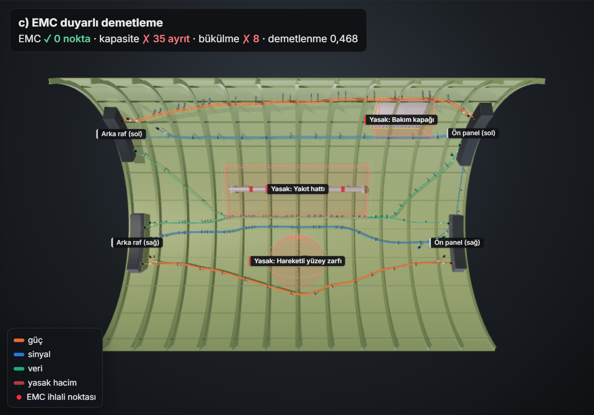 | 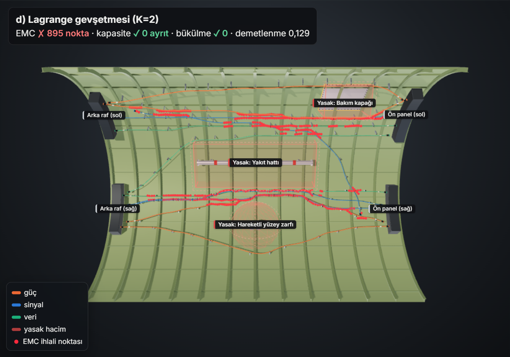 |
| **e) Integrated** | **f) Branched harness** |
| 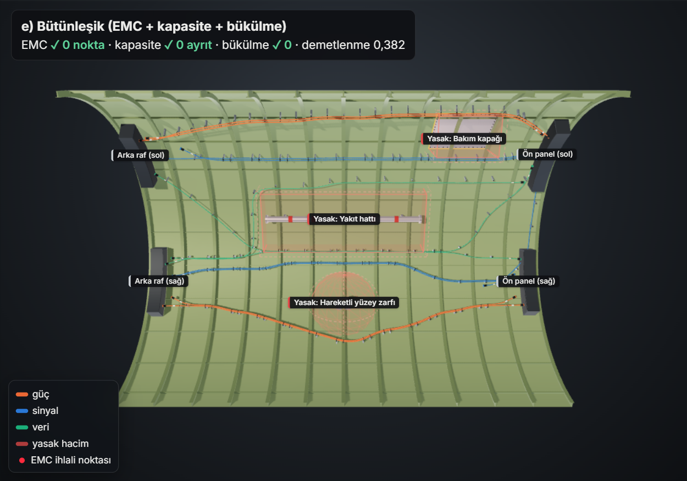 | 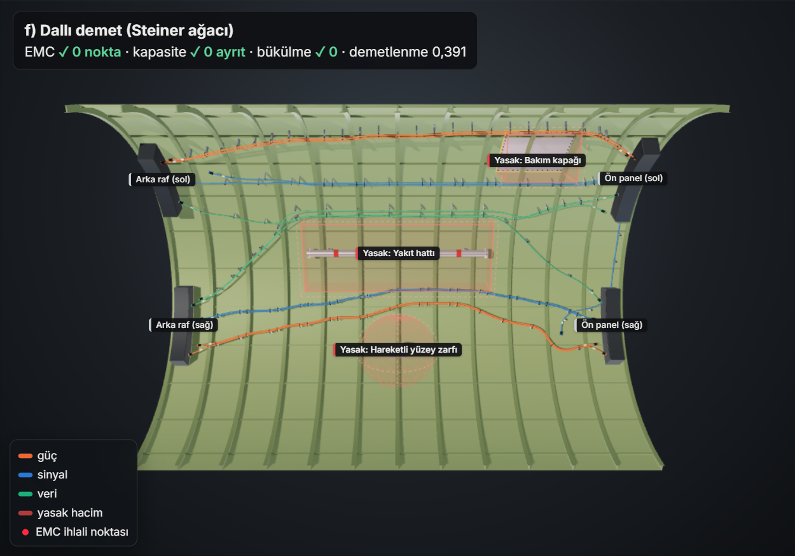 |


All images are captured from the interactive page with the same camera, looking up into the fuselage from
below ([`docs/index.html`](docs/index.html), all six methods on one page). In the images the bundle axis is
lifted ~10 cm off the surface, cables sharing a route are laid side by side inside the bundle and corners are
smoothed; this is visual only and does not enter the checks or metrics. Frames, stringers, clamps, connectors
and equipment racks are visual as well.

> Note: the README images, the Markdown reports in `outputs/` and the wirelist are generated with Turkish labels.
> The interactive page can be switched to English with the TR | EN control in its header.

## How to extend this in the real project

- **Capacitated Steiner forest:** Method (f) uses Steiner trees as a heuristic corridor. In the full model each
  edge is "opened" once (channel/support cost) and the cables passing over it are limited by capacity. This
  represents bundling directly in the objective instead of as a heuristic discount. With Lagrangian relaxation the
  subproblems still decompose into shortest-path / Steiner tree problems, which can be solved on the bend-aware
  turn graph.
- **EMC inside the Lagrangian framework:** The EMC penalty of the integrated method can be relaxed with
  separate multipliers for the separation constraints, turning a heuristic penalty into a model that
  produces lower bounds.
- **Node selection cost:** Node costs for branch points, pass-through holes and connection
  points; control over the number of bundle split/merge points.
- **Shielding as an active routing variable:** The shielded/unshielded choice enters the model
  as a decision variable that changes the separation requirement and has a cost/weight.
- **Clamp spacing:** Support points must be placeable along the route at allowed intervals;
  proximity to suitable structural attachment points.
- **Cable order:** The robustness benchmark measures the order sensitivity of sequential methods; the simple
  ordering heuristics available through `--order` did not beat the default order in this scenario. In the real
  project, fully simultaneous (Lagrangian-based) methods can reduce the dependence.
- **A mesh-independent bend criterion:** As the convergence study shows, the three-vertex circumradius tolerates
  sharp kinks on a coarse mesh. Bending should be measured as the turning angle over a fixed arc length (or on a
  smoothed curve), with a turn graph that keeps a history of more than one edge.
- **Real geometry and export to CAD:** STL/OBJ/PLY skins can now be read, `routes.json` gives 3D polylines and
  `harness_developed.dxf` a true-length developed view. Next steps: structural constraints such as frames,
  stringers and mandatory clamp points; export of the harness to exchange formats such as KBL/VEC (they need
  topology, connector and part data that this demo does not have); re-placing the branch points on the plane for a
  formboard.

## License

[MIT](LICENSE). Embedded third-party components keep their own licenses: three.js (MIT) and the Inter font
(SIL Open Font License 1.1, [`vendor/fonts/LICENSE`](harness_demo/viewer/vendor/fonts/LICENSE)).

---

AI-assisted tools were used during development; design decisions and verification are our team's.
