# Kablo Demeti Rotalama Demosu — 3B gövde yüzeyinde EMC duyarlı otomatik rotalama

**Türkçe** | [English](README.en.md)

[](https://github.com/Goktugelbir/Emc-duyarli-kablo-rotalama/actions/workflows/ci.yml)

**Kabloları demetlerken EMC ayrım mesafesini, ayrıt kapasitesini, minimum bükülme yarıçapını ve yasak
hacimlere güvenlik payını birlikte gözeten bütünleşik rotalama, bu senaryoda demetlemenin yarattığı
5661 EMC ihlal noktasını, 116 kapasite ihlalini ve 15 bükülme ihlalini sıfıra indirirken demetlenme
oranını 0,382'de tutuyor.** Bütünleşik çözümün kablo listesinde ([`outputs/wirelist.csv`](outputs/wirelist.csv))
11 kablonun her biri bağımsız denetimlerle tek tek doğrulanır: hepsi `OK`, en sıkışık EMC ayrım payı +3,9 cm.

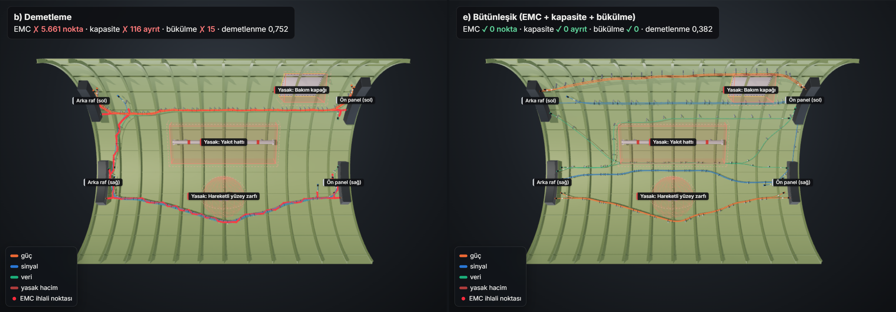

*Gövdeye alttan, kemerin içine bakış. Solda demetleme: kırmızı noktalar bağımsız denetimin bulduğu EMC
ihlalleridir. Sağda bütünleşik rotalama: tüm denetimler 0.*

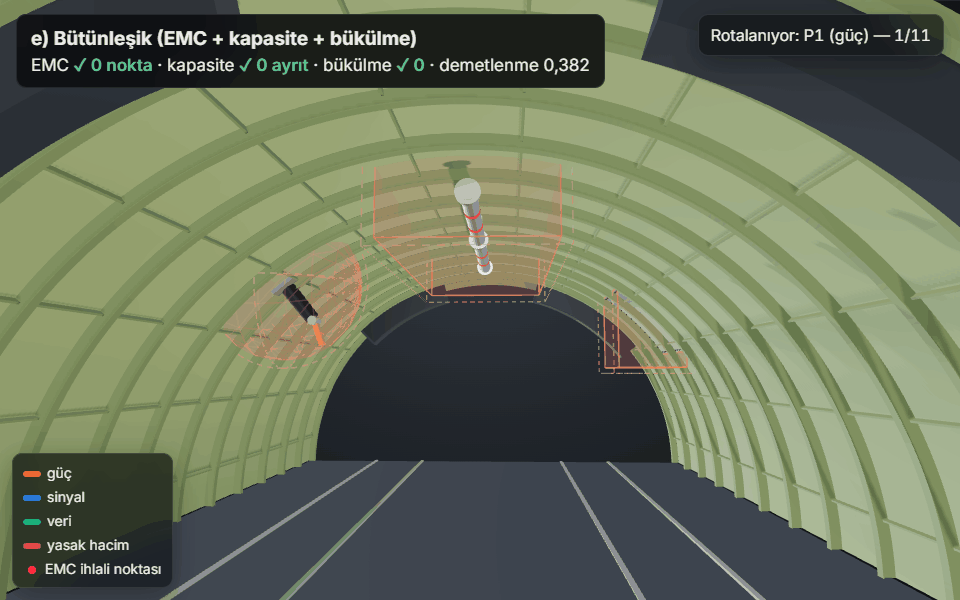

*Bütünleşik yöntem (e): kablolar, yöntemin onları rotaladığı sırayla tek tek döşenir; kelepçeler sonda belirir.*

**İçindekiler:** [Etkileşimli 3B görünüm](#etkileşimli-3b-görünüm) ·
[Giriş](#giriş) · [Problem](#problem) · [Kapsam](#kapsam) ·
[Kurulum ve çalıştırma](#kurulum-ve-çalıştırma) · [Proje yapısı](#proje-yapısı) ·
[Yöntemler](#yöntemler) · [Bağımsız denetimler](#bağımsız-denetimler) · [Sonuçlar](#sonuçlar) ·
[Doğruluk çalışmaları](#doğruluk-çalışmaları) ·
[Dışa aktarım](#dışa-aktarım-kablo-listesi-güzergâh-dosyası-ve-dxf-açınımı) · [Performans](#performans) ·
[Tüm yöntemler](#tüm-yöntemler) · [Asıl projede nasıl genişletilir](#asıl-projede-nasıl-genişletilir) ·
[Lisans](#lisans)

## Etkileşimli 3B görünüm

Altı yöntemin 3B görünümü arasında sekmelerle geçilebilen sayfa: **[goktugelbir.github.io/Emc-duyarli-kablo-rotalama](https://goktugelbir.github.io/Emc-duyarli-kablo-rotalama/)**
(yerel kopya: [`docs/index.html`](docs/index.html)).

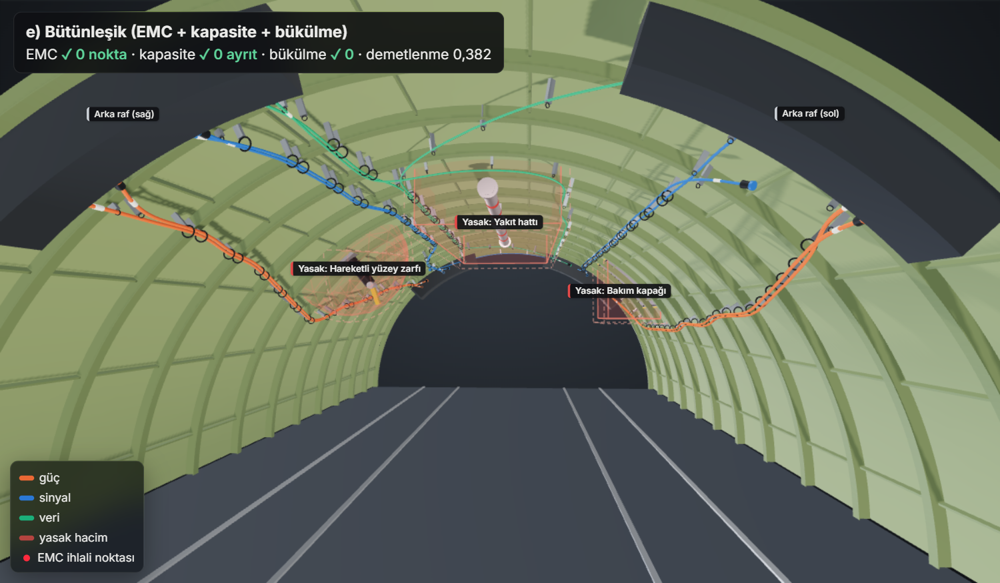

Sayfa three.js ile fiziksel tabanlı malzeme, ortam ışığı ve gölgelerle çizilir:

- içi astar boyalı, dışı yarı saydam alüminyum gövde kaplaması; frame, stringer ve zemin (koltuk rayları, zemin kirişleri),
- sınıfa göre kalınlığı değişen boru kablolar; aynı güzergâhı paylaşan kablolar demet içinde yan yana dizilir,
- demetler boyunca kelepçe ve dayanak braketleri, uçlarda konnektörler, kimlik kılıfları ve ekipman rafları,
- yasak hacimlerin içindeki donanım (kırmızı bantlı yakıt borusu, salınan aktüatör kolu, perçinli bakım kapağı)
  ve güvenlik payıyla büyütülmüş sınırları (kesikli kırmızı çizgi),
- **Rotalamayı oynat:** kablolar, yöntemin onları son kez rotaladığı sırayla (söküp yeniden rotalama dahil)
  tek tek döşenir; ihlal noktaları ve kelepçeler sonda belirir. Sayfa tüm kablolar çizili açılır, oynatma
  yalnızca Oynat düğmesiyle başlar,
- bir kablonun üzerine gelince adı, sınıfı, güzergâh uzunluğu ve **doğrulama payları** (EMC ayrım payı, en küçük
  bükülme yarıçapı, yasak hacme uzaklık, `OK`/`CHECK`); tıklayınca bağlandığı ekipman ve diğer sınıflara gereken
  en büyük ayrım mesafesi kadar yarı saydam bir zarf,
- her yöntem için tek satırlık bir özet (**✓ Tüm denetimler temiz** ya da **✗ N denetimde ihlal**, toplam uzunluk,
  demetlenme) ve açılır "Tüm metrikler" paneli; durum hiçbir yerde yalnızca renkle verilmez, her zaman ✓/✗ ile birlikte,
- **kablo tablosu:** seçili yöntemin her kablosu için sınıf, güzergâh, uzunluk, doğrulama payları, yakın paralel
  uzunluk ve durum; satıra tıklamak (ya da Enter) kabloyu 3B görünümde vurgular. Kablo bilgisi böylece dokunmatik
  ekranda ve klavyeyle de okunur,
- **yöntem karşılaştırması:** altı yöntemin toplam uzunluğu (çubuk), demetlenmesi ve hangi denetimlerden kaldığı
  tek tabloda; bir satır o yöntemi açar,
- **Türkçe / İngilizce:** başlıktaki TR | EN düğmesi bütün arayüz metinlerini, sayı biçimini (0,382 / 0.382) ve
  yöntem adlarını değiştirir; ilk açılışta tarayıcının dili izlenir, seçim sonra hatırlanır. Metinler
  [`viewer/i18n.json`](harness_demo/viewer/i18n.json) içindedir; senaryodan gelen adlar (yasak hacimler, ekipman)
  dosyadaki gibi kalır. README görselleri her zaman Türkçe üretilir,
- **tanıtım turu:** ilk ziyarette beş adımlık kısa bir tur yöntemleri, 3B görünümü, oynatmayı, katmanları ve kablo
  tablosunu gösterir. Tur sayfayı kilitlemez; `Esc` ya da × ile kapanır, başlıktaki **?** düğmesiyle yeniden açılır,
- **tema anahtarı** (güneş/ay): koyu tema siyaha yakın bir paletle gelir; anahtar ilk kullanıma kadar işletim
  sisteminin ayarını izler, sonra seçim tarayıcıda hatırlanır,
- **tam ekran düğmesi** (3B görünümün sağ üst köşesi, kısayol `F`, çıkış `Esc`); tarayıcı öğe tam ekranını
  desteklemiyorsa (ör. iPhone Safari) görünüm pencereyi doldurur,
- oynatmada **ilerleme kaydırıcısı** ve segmentli hız seçimi (0,5×–4×); kamera açıları (içeriden, alttan,
  dışarıdan, üstten) için segmentli kontrol ve katmanlar için açma/kapama çipleri (ok tuşlarıyla da gezilir);
  sayfa dışarıdan görünümle ve otomatik döndürme açık olarak açılır ("hareketi azalt" ayarında kapalı);
  dar ekranlarda görüş açısının otomatik ayarlanması,
- **paylaşılabilir bağlantı:** seçili yöntem, kamera açısı ve kablo adres çubuğunda tutulur
  (ör. `#m=integrated&v=inside&c=S4`); bağlantıyı açan aynı görünümü görür,
- klavye erişimi: sekmeler ok tuşları, Home ve End ile gezilir (`role="tab"`, `aria-controls`, `tabpanel`),
- çakışan etiketler otomatik gizlenir (önce yasak hacimler, sonra ekipman, en son kablo adları korunur); görünümün
  kenarından taşan etiketler de gösterilmez.

Bu gerçekçilik öğeleri yalnızca görseldir; kablo güzergâhları, ihlal noktaları ve metrikler doğrudan rotalama ve
bağımsız denetim sonuçlarıdır. Sayfa açılırken bütünleşik yöntemi (e) gösterir.

Sayfa **tamamen çevrimdışı çalışır**: three.js ve [Inter](https://rsms.me/inter/) yazı tipi (değişken ağırlıklı,
Latin + Latin Genişletilmiş; SIL OFL lisanslı) sayfanın içine gömülüdür ve sayfa ağdan hiçbir şey yüklemez. Sıkı bir
İçerik Güvenliği Politikası (CSP) yalnızca sayfanın kendi satır içi betiklerine (SHA-256 hash'leriyle) ve gömülü
yazı tiplerine izin verir. Ekrana veri basan her yer HTML'den kaçışlıdır. Boşta çizim yapılmaz; kare yalnızca kamera, oynatma, fare
ya da bir ayar değiştiğinde çizilir.

Pages'i açmak için: depo **Settings → Pages → Build and deployment → Source: "Deploy from a branch"**,
dal `main`, klasör `/docs` seçip kaydedin.

## Giriş

Bu depo, **uçak kablo demetlerinin üç boyutlu gövde geometrisi üzerinde EMC duyarlı otomatik
rotalanması** problemi için hazırlanmış küçük, basitleştirilmiş bir prototiptir. Amaç asıl
problemi çözmek değil; problemi doğru anladığımızı ve test edilebilir, modüler bir yazılım
iskeleti kurabildiğimizi göstermektir. Bu nedenle her sonuç, rotalama kodundan bağımsız
denetimlerle ölçülür; kod otomatik testlerle ve sürekli entegrasyonla (CI) korunur.

## Problem

Bir gövde kesiti üçgen yüzey modeli (mesh) olarak verilir. Her kablonun bir başlangıç ve bir
bitiş noktası ile bir EMC sınıfı (güç / sinyal / veri) vardır. İstenen, tüm kablolar için
yüzey üzerinde güzergâh üretmektir; öyle ki:

- kablolar mümkün olduğunca **demetlensin** (ortak güzergâh → daha az destek/kelepçe, daha az ağırlık),
- farklı EMC sınıfındaki kablolar arasında **ayrım mesafesi** korunsun,
- **yasak hacimlere** (yakıt hattı, hareketli yüzey zarfı, bakım kapağı vb.) girilmesin ve bunlara
  bir **güvenlik payından** daha fazla yaklaşılmasın,
- **minimum bükülme yarıçapı** ve bir güzergâh parçasından geçebilecek **en fazla kablo sayısı (kapasite)** aşılmasın.

Bu hedefler birbiriyle çelişir: demetleme kabloları bir araya toplar, EMC ise ayırmak ister;
kapasite demetin kalınlığını sınırlar, bükülme yarıçapı ise ani dönüşleri yasaklar.
Asıl projede problem kapasiteli Steiner ormanı olarak modellenip Lagrange gevşetmesiyle
çözülecektir; bu demo aynı problemin küçük ve basitleştirilmiş bir halini altı yöntemle ele alır.

## Kapsam

**Demo ne yapıyor**

- Yarıçapı 2 m, uzunluğu 6 m olan yarım silindir şeklinde temsilî bir gövde kesitini
  ~0,10 m aralıklı üçgen mesh olarak üretir (3904 köşe, 7560 üçgen; iç köşelere sabit seed'li
  küçük bir düzensizlik eklenir).
- Üç yasak hacim tanımlar (iki kutu, bir küre). Hacimleri 0,05 m güvenlik payı kadar büyütür; içlerinde
  kalan 429 düğümü ve bu büyütülmüş hacimleri kesen ayrıtları çizgeden çıkarır
  (kalan çizge: 3475 düğüm, 10033 ayrıt).
- 11 kablodan oluşan sentetik bir senaryo kurar (5 + 4 kablo iki yan tarafta paralel akar,
  2 kablo bir yandan diğerine geçer). Komşu uç noktalar farklı sınıftandır ve birbirine yakındır,
  ancak aralarındaki mesafe gereken ayrım mesafesinden büyüktür.
- Altı rotalama yöntemini çalıştırır (biri Steiner ağacına dayalı dallı demet); sonuçları rotalama kodundan
  bağımsız beş denetimle kontrol eder.
- Sıralı yöntemlerin kablo sırasına ve uç noktalara ne kadar duyarlı olduğunu 40 denemelik bir
  **sağlamlık testiyle** ölçer.
- Metrikleri (kablo kütlesi dahil) tablo olarak yazar; kablo listesini (`wirelist.csv`, kablo başına doğrulama
  paylarıyla), bütün güzergâhları 3B olarak (`routes.json`) ve demetin gerçek uzunluklu açınımını CAD için DXF
  olarak (`harness_developed.dxf`) dışa aktarır.
- Gövde yüzeyi isterseniz bir STL/OBJ/PLY dosyasından da okunabilir (aşağıda "Kendi senaryonuz").
- Her yöntem için 3B görsel, karşılaştırma görseli, rotalama animasyonu (GIF), metrik grafiği, Lagrange
  yakınsama grafiği, etkileşimli 3B sayfa ve çalışma günlüğü üretir.

**Demo ne yapmıyor**

- Kelepçe aralığı kısıtı yoktur (etkileşimli sayfadaki kelepçeler yalnızca görseldir).
- Gerçek uçak verisi, gerçek CAD geometrisi veya gerçek kablo listesi kullanılmamıştır (mesh dosyası okuma
  desteği vardır, ama yayımlanan sonuçlar üretilen yarım silindirdendir).
- Ekranlama (shielding) ataması yoktur; EMC yalnızca geometrik ayrım mesafesiyle temsil edilir.
- Lagrange formülasyonu **basitleştirilmiştir** (aşağıya bakınız); Steiner ormanı yapısı yalnızca f) yönteminde
  sezgisel olarak (sınıf başına bir Steiner ağacı) vardır. Kütle yalnızca kablo kütlesidir (bağ, kelepçe ve
  konnektör yoktur).
- Bükülme yarıçapı yalnızca e) ve f) yöntemlerinde rotalamaya katılır; diğer yöntemlerde sonradan denetlenir.
- KBL/VEC gibi kablo demeti değişim biçimlerine aktarım yoktur; DXF açınımı bir formboard düzeninin başlangıcıdır,
  dallanma noktalarını düzleme yeniden yerleştirmez.
- Kablolar yüzey üzerinde (mesh köşeleri boyunca) ilerler; yüzeyden uzaklaşan destekler yoktur.
- Güvenlik payı kutular için muhafazakârdır: büyütülmüş kutu, kutuya 0,05 m'den yakın tüm noktaları
  kapsar; köşelerde ise biraz daha fazlasını dışlar.

### Temsilî parametreler

Aşağıdaki değerlerin tamamı **temsilîdir**; herhangi bir standarttan veya gerçek bir uçaktan alınmamıştır.
Gövde ölçüleri, yasak hacimler, ayrım mesafeleri, bükülme yarıçapı, kablo çapları ve kablolar senaryo dosyasından
([`harness_demo/examples/fuselage_section.toml`](harness_demo/examples/fuselage_section.toml)) okunur; diğerleri yöntem parametreleridir.

| Parametre | Değer |
|:---|---:|
| Ayrım mesafesi power–signal | 0,15 m |
| Ayrım mesafesi power–data | 0,20 m |
| Ayrım mesafesi signal–data | 0,10 m |
| Aynı sınıf | 0 m |
| Minimum bükülme yarıçapı | 0,10 m |
| Yasak hacim güvenlik payı | 0,05 m |
| Ayrıt kapasitesi K | 2 kablo (kısıtın etkin olması için bilerek dar seçildi) |
| Demetleme indirim katsayısı | kullanılmış ayrıtın maliyeti × 0,4 |
| EMC cezası | ayrıt uzunluğu × 20 (ek maliyet); her yeniden rotalama turunda × 2 |
| Kapasite cezası (yöntem e) | dolu ayrıtta ayrıt uzunluğu × 1000 (ek maliyet) |
| Söküp yeniden rotalama turu | c: en çok 5, e: en çok 10 |
| Baştan yeniden başlatma (yöntem e) | çakışma kalırsa en çok 3 öncelik yükseltmesi, ardından diğer 3 sıralama stratejisi |
| Kablo dış çapı (kesit alanı modu, demet bükülme kuralı) | power 15 mm, signal 11 mm, data 10 mm |
| Kablo kütlesi | power 0,30 kg/m, signal 0,12 kg/m, data 0,08 kg/m |
| Demet çapı (demet bükülme kuralı) | 1,25 × √(Σ kablo çapı²); kural varsayılan olarak kapalıdır |
| Dallı demet (yöntem f) | sınıf ağacındaki yolu en kısa yoldan en çok %25 uzunsa koridor; koridor ayrıtı × 0,3 |
| Rastgelelik | mesh düzensizliği `seed = 42`, sağlamlık testi `seed = 7` |

## Kurulum ve çalıştırma

Python 3.11+ gerekir. Bağımlılık sürümleri [`requirements.txt`](requirements.txt) içinde **sabitlenmiştir**:
en kısa yol eşitliklerinin hangi yolla bozulacağı kütüphane sürümüne göre değişebilir ve bu, örneğin
Lagrange iterasyon sayısını değiştirir. Yayımlanan çıktılar tam olarak bu sürümlerle üretilmiştir.

```bash
pip install -r requirements.txt
```

```bash
python main.py
```

Bu komut tüm çıktıları yeniden üretir: `outputs/` altındaki metrik ve sağlamlık tabloları, 3B görseller
(`routes_*.png`, `comparison.png`, `viewer_inside.png`, `demo.gif`), 2B grafikler (`metrics_chart.png`,
`lagrangian_convergence.png`), `wirelist.csv`, `routes.json`, `harness_developed.dxf`, `run_log.txt` ve
`docs/index.html`. Bizim makinemizde toplam süre ~30 s'dir: ~11 s sağlamlık testi, ~16 s 3B görsellerin yakalanması, ~2 s 2B grafikler,
~2 s mesh, rotalama, denetimler ve dışa aktarım. Sayfa içinde süre ölçümü olmadığından aynı sonuçlar aynı sayfayı
üretir; sayfa değişmediyse 3B yakalama atlanır (~15 s; `--force-images` ile zorlanır). `--no-images` ile görseller
hiç üretilmez (~13 s).

Görüntü üretimi sistemde kurulu bir Chrome/Chromium kullanır (yoksa `plotly_get_chrome` komutuyla
indirilebilir). three.js sayfaya gömülü olduğu için ne görüntü üretimi ne de `docs/index.html`'i açmak internet
gerektirir. 3B görseller için Chrome kendi sandbox'ıyla ve eklentiler kapalı başlatılır; sandbox'ın açılamadığı
ortamlarda (ör. bazı Linux konteynerleri) `HARNESS_CHROME_NO_SANDBOX=1` ile kapatılabilir.

### Kendi senaryonuz

Rotalama problemi kodda değil, bir [TOML](https://toml.io) dosyasındadır. Örnek senaryo
[`harness_demo/examples/fuselage_section.toml`](harness_demo/examples/fuselage_section.toml) yorumlarıyla birlikte biçimi de anlatır. Kendi verinizi denemek için bu dosyayı kopyalayıp
düzenleyin:

```bash
python main.py --scenario senaryom.toml
```

| Bölüm | İçerik |
|:---|:---|
| `[scenario]` | ad ve kısa açıklama (isteğe bağlı) |
| `[fuselage]` | gövde yarıçapı ve uzunluğu [m]; mesh sıklığı, düzensizlik ve seed (isteğe bağlı) — **ya da** bir mesh dosyası (`mesh_file`, `scale`, `max_edge_m`, aşağıya bakınız) |
| `[rules]` | minimum bükülme yarıçapı [m]; isteğe bağlı: `capacity_k` (2), `clearance_m` (0,05), demet bükülme kuralı `bundle_bend_factor` (0 = kapalı) ve `bundle_diameter_factor` (1,25) |
| `[routing]` | isteğe bağlı maliyet ağırlıkları: `reuse_factor` (0,4), `emc_penalty` (20), `coupling_penalty` (0) |
| `[classes.<sınıf>]` | kullanılan EMC sınıfları (`power`, `signal`, `data`), dış çapları [m] ve isteğe bağlı kütleleri `mass_kg_per_m` (ya her sınıfta ya hiçbirinde) |
| `[separation_m]` | her sınıf çifti için gereken en küçük mesafe [m], ör. `power-data = 0.20` |
| `[[keep_out]]` | yasak hacimler: kutu (`lo`, `hi`) ya da küre (`center` veya kaplama üzerinde `center_on_surface`, `radius_m`) |
| `[[cables]]` | kablolar: ad, sınıf, iki uç kaplama üzerinde `{ x, theta, at }` ya da 3B nokta olarak `{ point = [x, y, z], at }` (`at`: ekipman adı, isteğe bağlı) |
| `[study]` | `--exact` karşılaştırmasının kabloları (isteğe bağlı) |

Dosya rotalamadan önce bütünüyle denetlenir. Eksik ya da fazla alan, yanlış tür, aralık dışı değer, tanımsız sınıf,
eksik sınıf çifti, aynı adlı iki kablo ve hatalı TOML sözdizimi, yeriyle birlikte tek seferde listelenir (ör.
`cables[3].from.theta: 0 ile 180 arasında olmalı`) ve çıkış kodu 2 olur. Geçersiz bir dosya için hiçbir çıktı
yazılmaz.

Senaryo dosyası başkasından gelebileceği için metinler ve boyutlar da sınırlıdır:

- adlarda (kablo, ekipman, yasak hacim, senaryo) ve açıklamada denetim karakteri, yeni satır ya da yön işareti
  olamaz; ad en çok 64, senaryo adı en çok 120, açıklama en çok 1000 karakterdir,
- dosya en çok 1 MiB; en çok 500 kablo ve 500 yasak hacim; `n_axial × n_circ` en çok 200 000 köşe;
  `[study] exact_cables` en çok 6 kablo,
- yasak hacimler gövde yüzeyinde hiç rotalanabilir ayrıt bırakmazsa çalışma anlaşılır bir mesajla durur (çıkış kodu 2).

Komut satırında verilen `--capacity`, `--clearance`, `--reuse-factor`, `--emc-penalty`, `--coupling-penalty` ve
`--bundle-bend-factor` senaryodaki değerin üzerine yazar; verilmezse senaryodaki değer, o da yoksa yukarıdaki
varsayılan kullanılır.

**Gerçek bir yüzey (mesh dosyası).** `[fuselage]` tablosunda `radius_m`/`length_m` yerine
`mesh_file = "govde.stl"` verilebilir (`.stl`, `.obj` ya da `.ply`; senaryo dosyasının klasöründe ya da alt
klasöründe olmalı, `..` ve mutlak yol reddedilir; en çok 50 MiB ve 200 000 köşe). `scale` birim çevirir (dosya
mm ise `0.001`), `max_edge_m` CAD'den gelen uzun üçgenleri bu kenar uzunluğuna kadar böler. Bu modda kablo uçları
ve küre merkezleri 3B nokta olarak verilir (`point = [x, y, z]`, `center = [x, y, z]`); x ekseni gövde ekseni
olmalıdır. Okunamayan ya da bozuk bir dosya senaryo hatası olarak raporlanır. İki sınırlama vardır: bükülme
yarıçapı düzenli ve ince bir üçgen ağında neredeyse hiç dönüşe izin vermeyebilir (komşu yönler 60° aralıklıdır;
`max_edge_m` bükülme yarıçapından küçük olmamalı; program dönüş çizgesi çok seyrekse uyarır), ve
`--convergence`, `--exact` ile DXF açınımı yalnızca üretilen yarım silindirle çalışır. 3B sayfadaki yapı
(frame, stringer) ve kamera açıları yarım silindire göre tasarlanmıştır.

### Komut satırı seçenekleri

| Seçenek | Varsayılan | Açıklama |
|:---|:---|:---|
| `--scenario DOSYA` | `harness_demo/examples/fuselage_section.toml` | senaryo dosyası (yukarıya bakınız) |
| `--no-images` | kapalı | PNG/GIF üretmez, Chrome gerekmez; metrikler, sağlamlık tablosu, günlük ve etkileşimli sayfa yine yazılır |
| `--trials N` | 20 | sağlamlık testinde her deney ailesi için deneme sayısı; `0` testi atlar |
| `--out DIR` | `outputs/` | çıktı klasörü |
| `--docs DIR` | `docs/` | etkileşimli sayfanın klasörü |
| `--capacity K` | senaryodan (2) | ayrıt kapasitesi |
| `--clearance M` | senaryodan (0.05) | yasak hacim güvenlik payı [m] |
| `--reuse-factor F` | senaryodan (0.4) | kullanılmış ayrıtın maliyet çarpanı (demetleme indirimi) |
| `--emc-penalty P` | senaryodan (20) | başka sınıfın rotasına yakın ayrıtların ek maliyeti × uzunluk |
| `--coupling-penalty P` | senaryodan (0) | e) ve f): ayrımın 2 katından yakın ayrıtların ek maliyeti × uzunluk (aşağıya bakınız) |
| `--bundle-bend-factor N` | senaryodan (0) | demet bükülme kuralı: dönüş yarıçapı ≥ N × demet çapı; 0 = kapalı |
| `--order STR` | `input` | kablo önceliklendirme stratejisi (`input`, `critical-first`, `longest-first`, `shortest-first`) |
| `--workers N` | Linux'ta 4, Windows/macOS'ta 1 | sağlamlık testi için paralel işlem sayısı; sonuç işçi sayısından bağımsızdır |
| `--strict` | kapalı | e) ana senaryoda ya da sağlamlık testinde bir denetimden kalırsa çıkış kodu 1 (CI bunu kullanır) |
| `--bundle-area-mm2 A` | 0 (kapalı) | kapasite kablo sayısı yerine demet kesit alanı olur; d), e), f) ve kapasite denetimi kesitleri toplar (aşağıya bakınız) |
| `--convergence` | kapalı | mesh yakınsama çalışmasını da çalıştırır → `convergence.md` (~5 s); en ince mesh 200 000 köşeyi aşacaksa iş başlamadan reddedilir |
| `--exact S` | 0 (kapalı) | küçük bir örnekte e)'yi kesin MILP çözümüyle karşılaştırır, `S` çözücü süre sınırıdır → `exact.md`; kesin çözüm mesh'i 10 000 köşeyi aşacaksa iş başlamadan reddedilir |
| `--force-images` | kapalı | sayfa değişmemiş olsa da 3B görselleri yeniden yakalar |

Sayısal seçenekler aralık denetiminden geçer: örneğin `--capacity 0`, `--clearance -1` ya da `--trials -1`
anlaşılır bir mesajla reddedilir. Uçlar çizgeye yerleştirildikten sonra senaryo bir kez daha denetlenir
(`scenarios.validate_scenario`): iki ucu
aynı düğüme düşen kablo ya da bilinmeyen EMC sınıfı hatadır (çıkış kodu 2); en yakın rotalanabilir düğüme 0,10
m'den fazla taşınan uç, farklı kablolarla paylaşılan uç düğüm ve farklı sınıftan uçların ayrım mesafesinden yakın
olması uyarı olarak yazılır. Yayımlanan senaryoda hiçbiri yoktur.

Örneğin yalnızca metrikleri ve sayfayı birkaç saniyede üretmek için:

```bash
python main.py --no-images --trials 0
```

Konsol çıktısının tamamı `outputs/run_log.txt` dosyasına da yazılır (yerel klasör yolları içermez).

### Testler ve sürekli entegrasyon

```bash
pip install -r requirements-dev.txt
```

```bash
pytest
```

[`tests/`](tests) altında 136 test vardır (~60 s; ikisi isteğe bağlıdır, aşağıya bakınız). Kapsam
`pytest --cov=harness_demo --cov=main` ile ölçülür; şu an %90'dır, CI %85'in altını kabul etmez:

- **Denetimler** (`test_checks.py`): çember yarıçapı, yeniden örnekleme, EMC, bükülme, kapasite,
  yasak hacim ve güvenlik payı sayımları elle hesaplanabilen küçük örneklerde doğrulanır.
- **Geometri ve çizge** (`test_geometry_graph.py`): büyütülmüş hacmin güvenlik payı komşuluğunu
  kapsaması, rotalanabilir düğümlerin paya uyması, hiçbir ayrıtın hacme girmemesi, bağlılık, simetri;
  vektörel ayrıt aramasının yönden bağımsız olması ve komşu olmayan düğümlerde hata vermesi; uçların doğru
  ekipmana atanması.
- **Rotalama** (`test_routing.py`): her yolun geçerli olması (doğru uçlar, gerçek ayrıtlar);
  baseline'ın networkx ile aynı uzunluğu bulması; dönüş çizgesinde U dönüşü ve keskin dönüş
  olmaması; e) yönteminin tüm denetimleri geçmesi; söküp yeniden rotalamanın rastgele sıralarda
  EMC ihlalini sıfırda tutması; rerotalamanın takıldığı dört sırada baştan yeniden başlatmanın e)'yi
  tüm denetimlerden temiz geçirmesi; Lagrange alt sınırının hiç azalmaması ve üst sınırı geçmemesi;
  uygun çözüm yokken Lagrange'ın NaN üretmeden temiz hata vermesi; sıralama stratejilerinin doğru sıralaması
  ve geçersiz stratejide hata vermesi.
- **Dışa aktarım** (`test_export.py`): kablo listesinin sütunları ve kablo numaraları; doğrulama paylarının
  bağımsız denetimlerle tutarlı olması; `routes.json`'un kompakt, eksiksiz ve byte düzeyinde deterministik olması.
- **Sağlamlık testi** (`test_benchmark.py`): uç nokta sapmasının farklı sınıftan uçları ayrım
  mesafesinin altına düşürmemesi; özet tablonun yapısı; **paralel çalıştırmanın sıralı çalıştırmayla aynı
  sonucu vermesi**; sağlamlık testindeki her yöntem tanımının çalışması.
- **Görüntüleyici** (`test_viewer.py`): üretilen sayfanın tek başına çalışır olması (bütün parçalar gömülü);
  `viewer.js`'in Node ile sözdizimi denetimi (Node yoksa atlanır); görüntüleyicinin okuduğu her `D.<alan>`'ın
  Python'un gömdüğü veride bulunması; `capture.py`'nin çağırdığı her `window.viewer` fonksiyonunun var olması;
  Türkçe ve İngilizce sözlüğün aynı anahtarları ve aynı `{yer tutucuları}` taşıması, sayfanın kullandığı her metin
  anahtarının sözlükte bulunması; Inter yazı tipinin gömülü olması. İsteğe bağlı bir test, sayfayı başsız Chrome'da
  açıp altı yöntemi gezer, İngilizceye geçer ve hiçbir JavaScript hatası olmadığını doğrular (Chrome gerektirir, internet gerekmez: `HARNESS_BROWSER_TESTS=1 pytest`). Gömülü three.js paketinin
  sabitlenen npm sürümünden üretildiği de denetlenir; paketin ve yazı tiplerinin SHA-256 değeri testte sabittir.
  Görüntü yakalamada Chrome'un sandbox'la, eklentisiz ve güvenliği gevşeten bayraklar olmadan başlatıldığı da test edilir.
- **Regresyon** (`test_regression.py`): yayımlanan metrik tablosunun (aşağıda) aynen üretilmesi.
- **Uçtan uca** (`test_cli.py`): `main.py --no-images` tüm dosyaları yazar, PNG üretmez, günlükte
  yerel yol yoktur, JSON geçerlidir ve sayfaya gömülen veri tutarlıdır; sayfada ağ bağımlılığı yoktur ve CSP,
  sayfadaki her çalıştırılabilir betiğe tam olarak kendi hash'iyle izin verir; geçersiz seçenekler mesajla
  reddedilir; `--strict` ve girdi hataları doğru çıkış kodunu verir.
- **Senaryo dosyası** (`test_scenario_file.py`): örnek dosyanın yayımlanan senaryoyu aynen vermesi; bozuk bir
  dosyadaki on bir farklı hatanın hepsinin yeriyle listelenmesi; eksik bölüm, sözdizimi hatası ve bulunamayan dosya;
  kürenin tek merkez tanımı; geçersiz dosyada `main.py`'nin çıkış kodu 2 vermesi ve hiçbir şey yazmaması.
- **Güvenilmeyen metin** (`test_untrusted_text.py`): senaryo dosyası başkasından gelebilir. `<!--<script>` gibi
  HTML'e benzeyen adlar sayfayı bozmaz (gömülü JSON'da `<`, `>`, `&` kaçışlanır), `constructor` gibi ekipman adları
  görüntüleyiciyi çökertmez, `=` ya da `@` ile başlayan adlar kablo listesinde formül olarak çalışmaz, markdown
  raporundaki adlar kaçışlanır; denetim karakteri, yeni satır ya da yön işareti içeren metinler, aşırı uzun adlar,
  çok büyük dosya, kablo listesi ve mesh reddedilir; bütün gövdeyi kaplayan yasak hacim temiz bir hata verir.
  İsteğe bağlı tarayıcı testi bu adlarla üretilen sayfanın hatasız açıldığını doğrular.
- **Bağımlılıklar** (`test_dependencies.py`): `requirements.txt` ve `requirements-dev.txt`'deki her sürümün
  CI'ın kurduğu `requirements-ci.lock`'ta aynı sürüm ve hash ile bulunması; görüntüleyici paketinin npm
  bağımlılıklarının tam sürümle, sha512 bütünlüğüyle ve npm kayıt defterinden kilitli olması.
- **Doğruluk** (`test_accuracy.py`): **özellik tabanlı testler** ([hypothesis](https://hypothesis.readthedocs.io/)):
  kesin nokta–kırık çizgi mesafesi rastgele kırık çizgilerde çok sık örneklemeyle karşılaştırılır ve hiçbir zaman
  gerçek mesafeden büyük çıkmaz; analitik doğru parçası–kutu/küre kesişimi sık örneklemeyle karşılaştırılır.
  Ayrıca örnek noktaların kaçırdığı bir ihlali kesin mesafenin yakalaması; ağırlıklı kapasite sayımı; senaryo
  doğrulamasının hataları ve uyarıları bulması; kesit alanı modunda e)'nin temiz olması; alt sınırın geçerliliği;
  yakın paralel uzunluk; ihlal noktalarının tekilleştirilmesi; yakınsama satırı; tek kablolu örnekte MILP
  optimumunun bükülme kısıtlı en kısa yolla aynı olması ve **e)'nin sağlamlık testinin 40 denemesinin 40'ında
  temiz olması**.
- **Yeni özellikler** (`test_features.py`): `[rules]`/`[routing]` değerlerinin okunması ve komut satırının bunların
  üzerine yazması; demet çapının ortak dönüşte doğru toplanması ve bükülme denetiminin dönüş başına sınır kullanması;
  e) ile f)'nin demet bükülme kuralına uyması; kuplaj cezasının yan yana koşuyu yarıdan fazla kısaltması; kütle
  metriği; Lagrange'ın kesit alanı modu; f)'nin sınıf ağaçlarının gerçekten ağaç olması ve koridorların dolambaç
  içermemesi; DXF'in yapısı, katmanları ve **açınımdaki uzunlukların 3B uzunluklarla aynı olması**; Türkçe adların
  DXF'te kaçışlanması; STL dosyasından okunan bir yüzeyde uçtan uca rotalama; klasör dışına çıkan, yanlış uzantılı,
  bulunamayan ya da bozuk mesh dosyalarının senaryo hatası vermesi.

Test, lint ve tip denetimi ayarları [`pyproject.toml`](pyproject.toml) içindedir. pytest `RuntimeWarning`
uyarılarını hataya çevirir; böylece NaN/sonsuz adımlar fark edilmeden geçemez. Kod [ruff](https://docs.astral.sh/ruff/)
ile denetlenir (`ruff check .`: pycodestyle, pyflakes, import sırası, bugbear, pyupgrade, simplify, ruff) ve
[mypy](https://mypy-lang.org/) ile tip denetiminden geçer (`mypy`; bulgu yok). Denetimler, hacimlerin yalnızca
şeklini bir `Protocol` ile tanımlar; böylece geometri modülünü içe aktarmadan da tip güvenli kalır.
GitHub Actions iş akışı ([`.github/workflows/ci.yml`](.github/workflows/ci.yml)) her push ve pull request'te
**Python 3.11, 3.12 ve 3.13** ile lint'i, tip denetimini, testleri ve `python main.py --no-images --trials 3 --workers 2 --strict`
duman testini (paralel yol dahil; e) bir denetimden kalırsa iş başarısız olur) çalıştırır. 3.11 işi testleri
kapsam ölçümüyle ve **başsız Chrome'daki görüntüleyici testleriyle** (`HARNESS_BROWSER_TESTS=1`) çalıştırır;
Chrome'un sandbox'ı açık kalsın diye Ubuntu 24.04'ün kullanıcı ad alanı kısıtı bu iş için kaldırılır. Çıktılar ve
`coverage.xml` artefakt olarak saklanır. Ayrı bir iş pip ve npm denetimlerini yapar. Tedarik zinciri sıkılaştırılmıştır:

- CI paketleri hash'leriyle kurar (`pip install --require-hashes --no-deps -r requirements-ci.lock`). Kilit dosyası
  `requirements-dev.txt`'den bütün Python sürümleri ve platformlar için tek dosya olarak üretilir:
  `uv pip compile requirements-dev.txt --generate-hashes --universal --python-version 3.11 -o requirements-ci.lock`.
- `pip-audit` her çalıştırmada kilit dosyasını bilinen güvenlik açıklarına karşı tarar. (İlk taramada pillow
  12.3.0'da 39 bilinen açık çıktı; pillow 13.0.0'a yükseltildi.)
- Görüntüleyici paketinin npm bağımlılıkları kurulum betikleri çalıştırılmadan kurulur
  (`npm ci --ignore-scripts`); `npm audit` bilinen açıkları, `npm audit signatures` kayıt defteri imzalarını denetler.
- Action'lar etiketle değil tam commit SHA'sıyla sabitlenmiştir; checkout kimlik bilgisini saklamaz.
- [Dependabot](.github/dependabot.yml) action'ları, pip bağımlılıklarını ve three.js paketinin npm bağımlılıklarını
  aylık günceller.

### Görüntülerle ilgili teknik notlar

- **README'deki tüm 3B görseller etkileşimli sayfanın kendisinden yakalanır** (`harness_demo/capture.py`).
  Sayfa başsız Chrome'da yakalama modunda (`docs/index.html?capture`) açılır; bu modda yalnızca 3B görünüm
  gösterilir ve sayfa, yöntem seçmek, kamerayı yerleştirmek ve rotalama ilerlemesini ayarlamak için bir
  `window.viewer` arayüzü sunar. Chrome, kaleido'nun da kullandığı `choreographer` kütüphanesiyle
  DevTools protokolü üzerinden sürülür. Yani README'de görülen, sayfada etkileşimli olarak görülenle birebir aynıdır.
- Görsellerin başlıklarındaki sayılar sayfaya gömülü metriklerden gelir. Kırmızı noktalar, `checks.py`'nin
  bulduğu EMC ihlal noktalarının kendisidir (yakalama modunda daha görünür olmaları için iki kat büyük çizilir).
  Kod, her yöntem için nokta sayısının tablodaki değerle aynı olduğunu `assert` ile doğrular.
- Pillow yalnızca hazır ekran görüntülerini yan yana yerleştirmek ve GIF karelerini birleştirmek için kullanılır;
  piksel düzeyinde düzenleme yapılmaz. GIF'te kamera sabittir ve tüm kareler ortak bir palet kullanır
  (EMC sınıf renkleri palette garanti edilir). Böylece dosya yalnızca değişen bölgeleri saklar ve küçük kalır
  (~200 KB).
- Metrik grafiği ve Lagrange yakınsama grafiği plotly ile çizilir (`harness_demo/visualize.py`).
- Görüntüleyicinin kaynağı [`harness_demo/viewer/`](harness_demo/viewer) altındadır: HTML iskeleti
  (`template.html`), stil (`viewer.css`), görüntüleyici kodu (`viewer.js`) ve gömülü three.js paketi
  (`vendor/three.bundle.min.js`, 687 KB). Paket, `vendor/package.json`'da sabitlenen three@0.169.0'dan esbuild ile
  bir kez üretilir; `package-lock.json` npm paketinin sha512 bütünlüğünü kaydeder. Yeniden üretmek için
  `vendor/` içinde `npm ci --ignore-scripts && npm run build && npm run fonts` (ikincisi Inter yazı tipini `fonts/`'a kopyalar). `presentation.py` hepsini verilerle birlikte tek
  bir `docs/index.html` dosyasına birleştirir ve CSP'yi sayfadaki betiklerin hash'lerinden hesaplar; böylece
  sayfa hem GitHub Pages'te hem de dosyadan, internetsiz açıldığında çalışır.
- Büyük sayısal diziler (mesh köşeleri ve üçgenleri, ihlal noktaları) sayfaya base64 tipli dizi olarak gömülür;
  ihlal noktaları 5 mm'lik ızgarada tekilleştirilip milimetre cinsinden saklanır. Bu, gömülü veriyi ~350 KB'tan
  ~200 KB'a indirir. Sayfa, çalışma sırasındaki JavaScript hatalarını `window.__viewerErrors` içinde toplar;
  tarayıcı testi bunun boş kaldığını doğrular.

### Güvenlik

Proje [cloudflare/security-audit-skill](https://github.com/cloudflare/security-audit-skill) ile kaynak düzeyinde
denetlendi ve bulgular düzeltildi. Sunucu, hesap, gizli anahtar ve ağ isteği yoktur; saldırı yüzeyi, başkasından
gelebilecek bir senaryo dosyasıdır. Bu yüzden:

- **Senaryo metinleri güvenilmeyen girdi sayılır** (yukarıdaki "Kendi senaryonuz" sınırları); hata iletileri garip
  karakterleri kaçışlanmış gösterir, konsola ve `run_log.txt`'ye sahte satır yazılamaz.
- **Sayfa:** gömülü JSON'da `<`, `>`, `&` `\u003c`/`\u003e`/`\u0026` olarak yazılır, böylece hiçbir ad betik
  öğesini kapatamaz; görüntüleyici adları düz nesne anahtarı olarak değil `Map` ile tutar (`constructor` gibi adlar
  sorun olmaz); sıkı CSP ve HTML kaçışı yukarıda anlatıldığı gibidir.
- **Kablo listesi:** `=`, `+`, `-`, `@`, sekme ya da CR ile başlayan metin hücreleri `'` ile başlar, hesap tablosunda
  formül olarak çalışmaz. **Markdown raporları:** adlar ters eğik çizgiyle kaçışlanır.
- **Görüntü yakalama:** Chrome sandbox'la, eklentisiz ve `--disable-web-security`, `--allow-file-access-from-files`,
  `--disable-popup-blocking` bayrakları olmadan başlatılır.
- **Tedarik zinciri:** yukarıdaki CI maddeleri; gömülü dosyaların SHA-256 değerleri testte sabittir.

Her madde [`tests/test_untrusted_text.py`](tests/test_untrusted_text.py) ve `test_viewer.py` içindeki bir regresyon
testiyle korunur.

## Proje yapısı

### Mimari

`python main.py` aşağıdaki adımları sırayla çalıştırır (`main.py` içindeki `run` fonksiyonu):

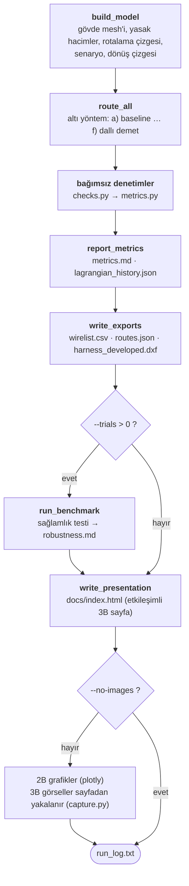

Modüllerin birbirini nasıl kullandığı (ok yönü: kullanılan → kullanan; sadeleştirilmiştir: `geometry`, `graph`
ve `scenarios`'un sonraki modüllerce doğrudan kullanımı ayrıca çizilmemiştir). `checks.py` hiçbir proje modülünü
içe aktarmaz: denetimler, doğruladıkları rotalama koduna bağlı değildir. `capture.py` da sayfayla yalnızca
tarayıcı üzerinden konuşur.

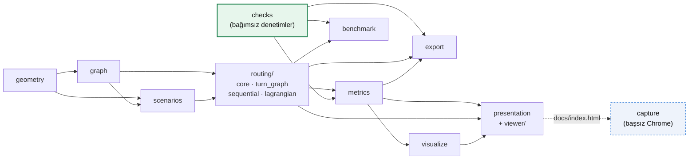

### Dosyalar

```
harness_demo/
  geometry.py    # parametrik yarım silindir mesh'i + yasak hacimler (kutu, küre), güvenlik payıyla büyütme
  graph.py       # mesh -> rotalama çizgesi (networkx), yasak düğüm/ayrıt temizliği, CSR çıktısı
  scenarios.py   # senaryo dosyasının okunması ve denetimi, mesh dosyasının okunması, uçların çizgeye
                 # yerleştirilmesi, uç nokta sapması, senaryo doğrulaması
  examples/      # örnek senaryo: fuselage_section.toml (11 kablo, üç yasak hacim, EMC kuralları)
  routing/       # 6 rotalama yöntemi (dışarıya tek API: from harness_demo.routing import ...)
    core.py        # sonuç tipi, Dijkstra, güzergâh örnekleme, a) baseline
    turn_graph.py  # bükülmeyi bilen dönüş çizgesi
    sequential.py  # b) demetleme, c) EMC duyarlı, e) bütünleşik, f) dallı demet; söküp yeniden rotalama,
                   # kuplaj cezası, demet bükülme kuralı
    lagrangian.py  # d) Lagrange gevşetmesi
  checks.py      # bağımsız denetimler (rotalama kodunu kullanmaz) ve denetim ayarları
  metrics.py     # metrikler ve tablo biçimlendirme
  benchmark.py   # sağlamlık testi: rastgele kablo sırası ve uç nokta sapması (isteğe bağlı paralel)
  convergence.py # mesh yakınsama çalışması (1×, 1,5×, 2× mesh)
  exact.py       # küçük örnekte kesin MILP çözümü (HiGHS, scipy.optimize.milp)
  visualize.py   # 2B grafikler (plotly): metrik grafiği, Lagrange yakınsaması
  presentation.py# etkileşimli sayfa: görüntüleyiciyi ve sonuçları tek bir HTML dosyasına birleştirir
  viewer/        # görüntüleyicinin kaynağı: template.html, viewer.css, viewer.js (yakalama modu dahil),
                 # i18n.json + i18n.js (Türkçe / İngilizce arayüz metinleri)
    vendor/      # gömülü three.js paketi, Inter yazı tipi (fonts/) ve onları üreten sabitlenmiş npm yapılandırması
  capture.py     # README 3B görsellerini sayfadan başsız Chrome ile yakalar (PNG + GIF)
  export.py      # kablo listesi (wirelist.csv, doğrulama paylarıyla) ve 3B güzergâhlar (routes.json)
  dxf.py         # demetin gerçek uzunluklu açınımı (harness_developed.dxf, DXF R12, mm)
main.py          # uçtan uca çalıştırma: build_model -> route_all -> report_metrics -> write_exports
                 #   -> run_benchmark -> write_presentation; komut satırı seçenekleri
tests/           # pytest testleri (136 test; ikisi isteğe bağlı tarayıcı testi)
outputs/         # 3B görseller (PNG, GIF), 2B grafikler, wirelist.csv, routes.json, harness_developed.dxf,
                 # metrics.md, robustness.md, convergence.md, exact.md, lagrangian_history.json, run_log.txt
docs/index.html  # GitHub Pages için tek sayfalık etkileşimli 3B görünüm
.github/workflows/ci.yml   # 3.11/3.12/3.13 matrisi: hash'li kurulum + lint + tip denetimi + testler (kapsam, tarayıcı)
                           #   + --strict duman testi; ayrı işte pip-audit + npm audit
.github/dependabot.yml     # action, pip ve npm güncellemeleri
pyproject.toml   # pytest, coverage, ruff ve mypy ayarları
LICENSE          # MIT lisansı (gömülü three.js: MIT, Inter: OFL)
requirements.txt / requirements-dev.txt   # sabitlenmiş sürümler (geliştirme: pytest, pytest-cov, ruff, mypy, hypothesis,
                                          #   pip-audit)
requirements-ci.lock       # CI için hash'li, bütün Python sürümlerini kapsayan kilit dosyası
```

## Yöntemler

**a) Baseline.** Her kablo için ayrıt ağırlığı = Öklid uzunluğu olan çizgede bağımsız Dijkstra.

**b) Demetleme.** Kablolar senaryo sırasıyla rotalanır; başka bir kablonun kullandığı her
ayrıtın maliyeti 0,4 katsayısıyla düşürülür. Böylece sonraki kablolar mevcut güzergâhlara katılır.

**c) EMC duyarlı demetleme.** (b)'ye ek olarak, bir kablonun güzergâhına
`ayrım mesafesi + 0,03 m` mesafedeki düğümler, diğer EMC sınıfları için "riskli" işaretlenir.
Bu komşuluk `scipy.spatial.cKDTree.query_ball_point` ile yalnızca güzergâhın çevresinde
hesaplanır. Farklı sınıftan bir kablo, riskli düğüme dokunan ayrıtlarda ek ceza öder.
Ceza yumuşaktır: gerekirse ihlal edilebilir, ama pahalıdır.

Sıralı rotalama kablo sırasına bağlıdır: bir kablo yalnızca kendinden önce rotalananları "görür".
Bu yüzden ilk geçişin ardından **söküp yeniden rotalama** (rip-up and reroute) yapılır.
Rotalayıcı kendi çakışma ölçüsüyle (ayrım mesafesinin altına düşen örnek noktalar ve varsa
kapasitesi aşılan ayrıtlar) çakışan kabloları bulur. Bu kabloları, en çok çakışandan başlayarak
sırayla söker ve yeniden rotalar; bu kez **diğer tüm** kabloları görür ve EMC cezası her turda
iki katına çıkar. Çakışma kalmayınca ya da tur sınırına gelince durur. Görülen en iyi çözüm
döndürülür, böylece yeniden rotalama sonucu hiçbir zaman kötüleştiremez. (Rotalayıcının çakışma
ölçüsü yalnızca neyin yeniden rotalanacağına karar verir; raporlanan metrikler bağımsız
denetimlerden gelir.)

**d) Basitleştirilmiş Lagrange gevşetmesi.** Çözülen model şudur:

```
min  Σ_k uzunluk(P_k)                    (P_k: k. kablonun yolu)
s.t. yük_e = Σ_{k : e ∈ P_k} l_k ≤ K     her ayrıt e için
```

l_k kablonun yüküdür: 1 (kablo sayısı) ya da kesit alanı modunda kablonun kesiti (K = demet alanı).
Kapasite kısıtı λ_e ≥ 0 çarpanlarıyla amaç fonksiyonuna taşınır:

```
L(λ) = Σ_k SP_k(w + l_k · λ) − K · Σ_e λ_e
```

Böylece problem her kablo için bağımsız bir en kısa yol alt problemine ayrışır ve L(λ) her
λ için optimumun **alt sınırıdır**. λ, Polyak adım boyuyla izdüşümlü subgradient
(`g_e = yük_e − K`) ile güncellenir. Her iterasyonda, kapasitesi dolan ayrıtları kapatarak
`w + λ` maliyetleriyle sıralı rotalayan bir onarım sezgiseli uygun bir çözüm, yani **üst sınır**
üretir. Alt ve üst sınır her iterasyonda kaydedilir.

Polyak adımı hedef değer olarak en iyi üst sınırı kullanır. Henüz uygun çözüm bulunmamışsa
(üst sınır sonsuzsa) hedef, en iyi alt sınırın %5 üstü alınır. Böylece adım her zaman sonludur.
(Önceki sürümde bu durumda adım sonsuz olup çarpanlar NaN'a dönüşüyordu; bir test bu durumu korur.)
Bilinmeyen sınırlar `lagrangian_history.json` dosyasına `null` olarak yazılır.

> Bu, asıl projedeki formülasyonun **basitleştirilmiş** halidir: burada amaç yalnızca
> toplam kablo uzunluğudur ve demetleme (paylaşılan ayrıtın bir kez ödenmesi) modelde yoktur.
> Asıl projede amaç kapasiteli Steiner ormanı yapısını, EMC kısıtlarını ve düğüm seçim
> maliyetlerini içerecektir.

**e) Bütünleşik yöntem (EMC + kapasite + bükülme).** (c)'nin demetleme, EMC cezası ve söküp yeniden
rotalama mantığı, bükülmeyi bilen bir **dönüş çizgesi** üzerinde çalıştırılır:

- **Bükülme sert kısıttır.** Dönüş çizgesinin her durumu yönlü bir ayrıttır (u→v); bir geçiş
  (u→v)→(v→w) ancak w ≠ u ise ve u, v, w'den geçen çemberin yarıçapı minimum bükülme yarıçapından
  küçük değilse vardır. Bu, bağımsız bükülme denetiminin test ettiği koşulun ta kendisidir. Bu yüzden
  bulunan her yolun bükülme ihlali yapısal olarak 0'dır. Bu senaryoda 109 924 olası dönüşün %53'ü
  (90°'lik dönüşler gibi) elenir, 51 544'ü kalır. Bir durumun maliyeti o ayrıta girerken ödenir.
  Sanal kaynak, başlangıç düğümünden çıkan tüm ayrıtlara; bitiş düğümüne giren tüm ayrıtlar ise
  sanal hedefe bağlanır, böylece uçlarda dönüş kısıtı yoktur (konnektör).
- **Kapasite**, dolu bir ayrıtta (başka K kablo taşıyan) uzunluğun 1000 katı ek maliyetle
  pratikte serttir. Ama geometri izin vermezse rotalama başarısız olmaz; ihlal raporlanır.
- **EMC ve demetleme** (c)'deki gibidir. Söküp yeniden rotalama kapasite çakışmalarını da hesaba katar
  ve en çok 10 tur sürer.
- **Baştan yeniden başlatma.** Kabloları tek tek yeniden rotalamak bazı sıralarda takılır: her turda
  aynı yollar geri gelir ya da büyüyen EMC cezası EMC çakışmasını yalnızca bir kapasite çakışmasıyla
  takas eder (dar K = 2 yüzünden, bir kablonun başka bir demeti uçtan dolaşacağı şerit doludur). Tur
  sınırına gelindiğinde hâlâ çakışma varsa geçişin tamamı baştan yapılır ve **çakışan kablolar önce**
  rotalanır (öncelik yükseltme; en çok 3 kez). Hâlâ çakışma kalırsa diğer üç sıralama stratejisinin
  her biriyle birer kez daha denenir. İlk çakışmasız çözümde durulur; bu yüzden zaten çakışmasız olan
  bir çözüme (ana senaryo dahil) hiç dokunulmaz. `restarts=0` bu adımı kapatır.
- **İsteğe bağlı iki kural daha** (bkz. "Demet bükülme kuralı ve kuplaj cezası"): demet büyüdükçe artan bükülme
  yarıçapı (dönüş başına maliyet) ve farklı sınıftan rotaların yan yana koştuğu uzunluğa ceza.

**f) Dallı demet (Steiner ağacı).** Gerçek bir kablo demeti noktadan noktaya kablolardan değil, dallanan bir
ağaçtan oluşur: gövdeler (trunk) ekipmana doğru kollara ayrılır. f) önce her EMC sınıfı için o sınıfın bütün
uçlarını bağlayan bir **Steiner ağacı** kurar (Mehlhorn'un 2-yaklaşımı, networkx). Ağaçlar sırayla (power, signal,
data) kurulur; önceki sınıfların ağaçlarına ayrım mesafesinden yakın ayrıtlar EMC cezası öder, böylece sınıfların
gövdeleri ayrı kalır. Sonra her kablonun ağaç içindeki yolu o kablonun **koridoru** olur ve koridor ayrıtları
uzunluğun 0,3 katına iner; kablolar e)'deki gibi (bükülme sert kısıt, kapasite, EMC, söküp yeniden rotalama,
yeniden başlatma) rotalanır. Böylece kablolar ortak gövdede toplanır ve yalnızca bir kolun, bükülmenin,
kapasitenin ya da EMC ayrımının gerektirdiği yerde ondan ayrılır. Ağaç yolu kablonun en kısa yolundan %25'ten
uzunsa (ör. sınıf ağacı sağ ve sol tarafı birbirine bağladığı için) o kablonun koridoru yoktur. Bu kural
olmadan ilk denemede kablolar ağaç boyunca dolaşıyor ve toplam uzunluk 83 m'ye çıkıyordu.

## Bağımsız denetimler

`checks.py` rotalama modülünü veya çizgeyi kullanmaz; yalnızca düğüm listelerini ve köşe
koordinatlarını alıp her şeyi geometriden yeniden hesaplar:

- **EMC ihlali:** Güzergâhlar 0,05 m aralıkla yeniden örneklenir. Bir örnek nokta, farklı
  sınıftan bir güzergâha gereken ayrım mesafesinden yakınsa ihlal sayılır (her ihlal eden
  güzergâh için bir kez). Birim: nokta. Mesafe diğer güzergâhın **doğru parçalarına kesin olarak** ölçülür, yalnızca
  örnek noktalarına değil: en yakın örnek nokta, gerçek en yakın noktadan en fazla 2,5 cm uzakta olabilir ve
  eşiğe yakın sığ bir ihlali (ayrımı 0,10 m olan bir çiftte ~3 mm'ye kadar) kaçırabilirdi. Kesin hesap yalnızca
  eşiğe bu kadar yakın noktalar için yapılır. Bu değişiklik baseline'da 7, demetlemede 1, Lagrange çözümünde 8
  kaçırılmış ihlal noktası buldu; c) ve e) yine 0'dır.
- **Bükülme:** Ardışık üç köşeden geçen çemberin yarıçapı 0,10 m'den küçükse ihlal (yaklaşık bir ölçüt).
- **Yasak hacim:** 0,05 m aralıklı örnek noktalardan biri bir kutu/küre içindeyse ihlal.
- **Güvenlik payı:** Bir örnek nokta hacmin dışında ama ona 0,05 m'den yakınsa ihlal. Uzaklık
  hacmin ham parametrelerinden tam olarak hesaplanır (kutuya Öklid uzaklığı, küre yüzeyine uzaklık).
  Denetimin gerçekten çalıştığını göstermek için `main.py`, baseline'ı güvenlik payı **olmadan**
  kurulan çizgede de rotalar: bu durumda 69 güvenlik payı ihlal noktası çıkar.
- **Kapasite:** K'dan fazla kablo taşıyan ayrıt sayısı (kesit alanı modunda: kablo kesitleri toplamı demet alanını
  aşan ayrıt sayısı).

Çizge kurulurken bir ayrıtın yasak hacmi kesip kesmediği de artık **analitik** olarak (kutu için slab yöntemi,
küre için doğru parçası–merkez uzaklığı) bulunur; önceden ayrıt üzerindeki 5 ara noktaya bakılıyordu. Bu senaryoda
fark yoktur (rotalanabilir düğümler arasında fazladan kesilen ayrıt çıkmadı), ama test artık örneklemeye bağlı değildir.

## Sonuçlar

`python main.py` çıktısı (`outputs/metrics.md` ile aynı):

| Yöntem | Toplam uzunluk [m] | Benzersiz uzunluk [m] | Demetlenme oranı | Kablo kütlesi [kg] | EMC ihlali [nokta] | Bükülme ihlali | Yasak hacim ihlali | Boşluk payı ihlali [nokta] | Kapasite ihlali [ayrıt] | Süre [s] |
|:---|---:|---:|---:|---:|---:|---:|---:|---:|---:|---:|
| a) Baseline (bağımsız Dijkstra) | 61.66 | 51.65 | 0.162 | 10.84 | 987 | 0 | 0 | 0 | 20 | 0.00 |
| b) Demetleme | 71.84 | 17.80 | 0.752 | 12.37 | 5661 | 15 | 0 | 0 | 116 | 0.01 |
| c) EMC duyarlı demetleme | 66.18 | 35.22 | 0.468 | 11.39 | 0 | 8 | 0 | 0 | 35 | 0.02 |
| d) Lagrange gevşetmesi (K=2) | 61.76 | 53.80 | 0.129 | 10.85 | 895 | 0 | 0 | 0 | 0 | 0.68 |
| e) Bütünleşik (EMC + kapasite + bükülme) | 66.05 | 40.80 | 0.382 | 11.32 | 0 | 0 | 0 | 0 | 0 | 0.04 |
| f) Dallı demet (Steiner ağacı) | 66.50 | 40.47 | 0.391 | 11.48 | 0 | 0 | 0 | 0 | 0 | 0.17 |

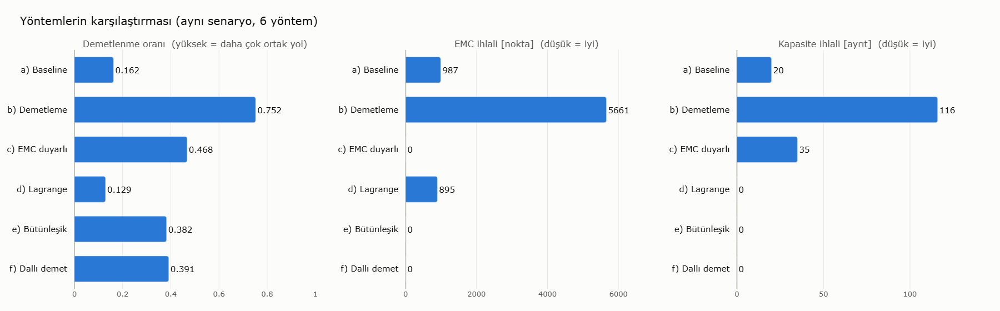

Lagrange: 60 iterasyon (iterasyon sınırı); alt sınır 61,7624 m, üst sınır 61,7639 m, fark 0,0014 m (%0,002).
**e) için optimalliğe uzaklık:** e)'nin her çözümü bükülme ve kapasite kısıtını sağladığından iki alt sınır
geçerlidir: bükülme kısıtlı en kısa yolların toplamı (61,66 m) ve kapasite kısıtlı problemin Lagrange alt sınırı
(61,76 m). Büyüğü alınınca e)'nin toplam uzunluğu (66,05 m), kısıtları sağlayan en kısa çözüme **en çok %6,5**
uzaktır. (EMC ayrımı alt sınırlarda yoktur; gerçek fark bundan küçüktür.)
Demetlenme oranı = 1 − benzersiz uzunluk / toplam uzunluk. Kablo kütlesi = Σ uzunluk × sınıfın kg/m değeri
(bağ ve kelepçe hariç). Süreler yalnızca rotalama süresidir (denetim ve çizim hariç); makineye göre değişir.

### Yorum

- **Baseline** en kısa toplam uzunluğu verir ama kabloları neredeyse hiç demetlemez (0,162).
  Buna rağmen 987 EMC ihlal noktası vardır: komşu uç noktalardan çıkan en kısa yollar yasak
  hacimlerin kenarında birbirine yaklaşır. EMC farkındalığı olmayan "sadece en kısa yol"
  yaklaşımı bu yüzden yeterli değildir.
- **Demetleme** benzersiz güzergâh uzunluğunu 51,7 m'den 17,8 m'ye indirir (oran 0,752).
  Bunun bedeli toplam kablo uzunluğunda ~%17 artış ve EMC ihlallerinde büyük bir artıştır
  (5661 nokta), çünkü farklı sınıftan kablolar aynı ayrıtları paylaşır. Kapasite ihlali (116 ayrıt)
  ve bükülme ihlali (15) de en yüksektir.
- **EMC duyarlı demetleme** bu senaryoda EMC ihlalini sıfıra indirirken demetlenme oranını
  0,468'de tutar: kablolar sınıf içinde demetlenir, sınıflar arasında ayrı güzergâhlar oluşur.
  Ancak kapasiteyi (35 ayrıt) ve bükülmeyi (8) gözetmez.
- **Lagrange** yöntemi baseline'ın 20 kapasite ihlalini yalnızca 0,11 m (%0,17) ek uzunlukla
  ortadan kaldırır. Alt ve üst sınır arasındaki fark 0,0014 m'dir (%0,002), yani bulunan çözüm bu
  basitleştirilmiş model ve bu çizge için optimuma en fazla 1,4 mm uzaktır. Modelde EMC ve demetleme
  olmadığından EMC ihlalleri baseline düzeyindedir.
- **Bütünleşik yöntem** beş denetimin hepsini aynı anda sağlayan ilk yöntemdir: EMC, bükülme,
  yasak hacim, güvenlik payı ve kapasite ihlalleri 0'dır. Toplam uzunluğu (66,05 m) (c)'den bile
  biraz kısadır. Demetlenme oranı (0,382) (c)'den düşüktür, çünkü K = 2 bir ayrıtta en fazla iki
  kablo olmasına izin verir; bu bilerek dar seçilmiş kapasitenin doğal bedelidir.
- **Dallı demet** de beş denetimin hepsini sağlar. Bu senaryoda e)'den 0,45 m (%0,7) uzun, benzersiz uzunluğu
  0,33 m kısadır (demetlenme 0,391): K = 2 bir gövdede en çok iki kabloya izin verdiğinden ağaç yapısının
  getirisi sınırlıdır. Gerçekçi kapasitede (kesit alanı modu) iki yöntemin farkı da küçüktür (aşağıya bakınız).
  f)'nin değeri, kablo başına ayrı yollar yerine sınıf başına bir gövde–kol yapısı önermesidir.
- Hiçbir yöntem yasak hacim veya güvenlik payı ihlali üretmemiştir; çizgeden büyütülmüş hacimlerin
  içindeki düğümler ve onları kesen ayrıtlar çıkarıldığı için bu beklenen sonuçtur ve bağımsız
  denetimle doğrulanmıştır.

### Sağlamlık testi: sonuç kablo sırasına mı bağlı?

Sıralı yöntemlerde tek bir "0 ihlal" sonucu şans olabilir. `benchmark.py` bunu iki deney ailesiyle
ölçer (her biri 20 deneme, `seed = 7`). **Rastgele sıra:** özgün senaryo, kablolar rastgele sırayla
rotalanır. **Uç nokta sapması:** ayrıca her uç nokta ±0,05 m eksenel ve ±1,5° çevresel kaydırılır.
Bu sınırlar, farklı sınıftan uçları ayrım mesafesinin altına düşürmeyecek kadar küçüktür (bir test
bunu doğrular). Tüm denemeler bağımsız denetimlerle ölçülür (`outputs/robustness.md`):

| Deney | Yöntem | EMC ihlali 0 olan | EMC ort. / en çok [nokta] | Kapasite ort. / en çok [ayrıt] | Bükülme en çok | Tüm denetimler temiz |
|:---|:---|---:|---:|---:|---:|---:|
| Rastgele sıra | c) tek geçiş | 6/20 | 24.1 / 72 | 59.1 / 116 | 13 | 0/20 |
| Rastgele sıra | c) + söküp yeniden rotalama | 20/20 | 0.0 / 0 | 70.7 / 116 | 18 | 0/20 |
| Rastgele sıra | e) Bütünleşik | 20/20 | 0.0 / 0 | 0.0 / 0 | 0 | 20/20 |
| Rastgele sıra | f) Dallı demet | 20/20 | 0.0 / 0 | 0.0 / 0 | 0 | 20/20 |
| Rastgele sıra + uç nokta sapması | c) tek geçiş | 7/20 | 16.0 / 56 | 57.5 / 108 | 10 | 0/20 |
| Rastgele sıra + uç nokta sapması | c) + söküp yeniden rotalama | 20/20 | 0.0 / 0 | 52.4 / 110 | 16 | 0/20 |
| Rastgele sıra + uç nokta sapması | e) Bütünleşik | 20/20 | 0.0 / 0 | 0.0 / 0 | 0 | 20/20 |
| Rastgele sıra + uç nokta sapması | f) Dallı demet | 20/20 | 0.0 / 0 | 0.0 / 0 | 0 | 20/20 |

- Söküp yeniden rotalama olmadan (c) yalnızca 40 denemenin 13'ünde EMC açısından temizdir; özgün
  senaryodaki "0 ihlal" sonucu bu yüzden kısmen sıraya bağlıydı. Söküp yeniden rotalamayla
  40 denemenin 40'ında EMC ihlali 0'dır.
- (c) kapasite ve bükülmeyi hiçbir sırada gözetmez; bu yüzden hiçbir denemede tüm denetimlerden temiz geçmez.
- (e) ve (f) 40 denemenin 40'ında beş denetimin hepsinden temiz geçer. Baştan yeniden başlatma olmadan
  (`restarts=0`) bu sayı 36'dır: kalan 4 denemede (hepsi özgün uç noktalarla, rastgele sırada) en
  fazla 10 EMC ihlal noktası kalıyordu. İkisinde S4, D2'yi kesiyor; ikisinde de bir power kablosu
  uç noktaları yakınında signal kablolarına 0,129 m ve 0,148 m'ye (gereken 0,15 m) yaklaşıyordu.
  Bu sıralar `test_routing.py` içinde regresyon testi olarak tutulur.
- Sonucun bu 40 denemeye uydurulmadığını görmek için aynı iki deney ailesi beş farklı seed ile
  (7, 1, 99, 123, 2024) aile başına 100 denemeyle de çalıştırıldı: e) yeniden başlatmayla
  **1000 denemenin 1000'inde** tüm denetimlerden temiz geçer; yeniden başlatma olmadan 954'ünde.
  Ceza yumuşak olduğundan bu bir garanti değildir; ama bu senaryoda ve bu sapmalarda kalan bir
  başarısızlık bulunamadı.

### Kablo önceliklendirme stratejileri (`--order`)

Sıralı yöntemlerin (b, c, e) ilk geçişi hangi sırayla yapacağı `--order` ile seçilebilir: `input` (senaryo
sırası, varsayılan), `critical-first` (önce power, sonra data, sonra signal; sınıf içinde uzun kablo önce),
`longest-first` ve `shortest-first` (uç noktalar arasındaki düz mesafeye göre). Bu senaryoda bağımsız
denetimlerle ölçülen sonuç:

| Strateji | c) EMC / kapasite / bükülme | c) toplam uzunluk | e) EMC / kapasite / bükülme | e) toplam uzunluk |
|:---|:---:|---:|:---:|---:|
| `input` | 0 / 35 / 8 | 66,18 m | 0 / 0 / 0 | 66,05 m |
| `critical-first` | 0 / 93 / 9 | 72,07 m | 0 / 0 / 0 | 72,00 m |
| `longest-first` | 0 / 93 / 9 | 72,07 m | 0 / 0 / 0 | 72,00 m |
| `shortest-first` | 0 / 110 / 9 | 79,46 m | 0 / 0 / 0 | 76,73 m |

Bütünleşik yöntem her stratejide tüm denetimlerden temiz geçer; ancak bu senaryoda hiçbir strateji varsayılan
sıradan iyi değildir: kablolar 6–11 m uzar ve (c)'nin kapasite ihlali artar. (`critical-first` ve
`longest-first` farklı sıralar üretse de söküp yeniden rotalamadan sonra c) ve e) için aynı çözüme varır.)
Sıra bağımlılığını asıl azaltan, yukarıdaki sağlamlık testinin gösterdiği gibi söküp yeniden rotalamadır;
stratejiler deneme için bir seçenektir.

## Doğruluk çalışmaları

### Mesh yakınsama: sonuçlar 0,1 m'lik mesh'e mi bağlı?

Ayrım mesafeleri (0,10–0,20 m) yalnızca bir iki mesh ayrıtı uzunluğundadır. `python main.py --convergence` aynı
geometri, yasak hacimler, uç noktalar ve parametrelerle mesh'i iki yönde 1,5 ve 2 kat sıklaştırıp baseline ve
bütünleşik yöntemi yeniden çalıştırır ([`outputs/convergence.md`](outputs/convergence.md)):

| Mesh | Ayrıt aralığı [m] | Düğüm | a) uzunluk [m] | a) EMC [nokta] | e) uzunluk [m] | e) / bükülme alt sınırı | e) EMC / kapasite / bükülme / yasak / boşluk | e) süre [s] |
|:---|---:|---:|---:|---:|---:|---:|:---:|---:|
| 1× | 0.100 | 3475 | 61.66 | 987 | 66.05 | 1.071 | 0 / 0 / 0 / 0 / 0 | 0.05 |
| 1.5× | 0.067 | 7694 | 61.22 | 734 | 65.80 | 1.074 | 0 / 0 / 0 / 0 / 0 | 0.14 |
| 2× | 0.050 | 13622 | 61.29 | 742 | 85.89 | 1.370 | 0 / 0 / 0 / 0 / 0 | 3.12 |

- **e) her mesh'te beş denetimin hepsinden temiz geçer.** 1× ve 1,5× mesh'te toplam uzunluk %0,4 içinde
  aynıdır; ana sonuç bu aralıkta mesh'e bağlı değildir.
- **2× mesh'te e) %30 daha uzun rotalar bulur.** Kök neden, bükülme ölçütünün mesh'e bağlı olmasıdır. Ardışık üç
  köşeden geçen çemberin yarıçapı, φ açısıyla kırılan ve ayrıtları L uzunluğunda olan bir köşe için
  R = L / (2·sin(φ/2))'dir. 45°'lik bir kırılma 0,1 m ayrıtlarda R = 0,131 m verir ve geçer; 0,05 m ayrıtlarda
  R = 0,065 m verir ve kalır. Yani kaba mesh keskin kırılmalara göz yumar. İnce mesh'te çapraz kablo S4'ün ön
  uçtaki dar şeridi dönerek kullanması mümkün olmaz ve kablo uzun bir dolambaçla temiz kalır. Bu, ölçütün
  kendisindeki bir sınırlamadır: daha doğru bir model bükülmeyi sabit bir yay uzunluğu boyunca (ör. 0,1 m'lik
  pencerede dönüş açısı) ölçmelidir.
- Bu çalışma ayrıca yeniden başlatma adımında bir iyileştirmeye yol açtı: önceden bulunan **ilk** temiz aday
  seçiliyordu; 2× mesh'te bu aday S2 için 17,7 m'lik bir dolambaç içeriyordu. Artık bütün adaylar denenir ve
  temiz olanlar arasından en kısası seçilir.

### Kesin çözümle karşılaştırma (küçük örnek)

Sıralı yöntemler sezgiseldir. `python main.py --exact 120`, e)'yi aynı problemin kesin karma tamsayılı modeliyle
(MILP) karşılaştırır ([`harness_demo/exact.py`](harness_demo/exact.py), [`outputs/exact.md`](outputs/exact.md)).
Model: amaç toplam uzunluk; her kablo dönüş çizgesinde bir akış (bükülme sert kısıt); her ayrıtta yük ≤ K;
farklı sınıftan iki kablonun, aralarındaki mesafe ayrımdan küçük olan iki ayrıtı birlikte kullanamaması (EMC).
Çözücü SciPy'nin içindeki HiGHS'tır; ek bağımlılık yoktur. Tam örnek (11 kablo) çözülemeyecek kadar büyük
olduğundan örnek, 0,2 m'lik mesh ve en zor çift olan S4 + D2'dir (sağlamlık testinde takılan sıraların ikisinde
birbirini kesen kablolar):

| Çözüm | Toplam uzunluk [m] | Denetimler (EMC / kapasite / bükülme / yasak / boşluk) | Süre [s] |
|:---|---:|:---:|---:|
| e) Bütünleşik | 12.456 | 0 / 0 / 0 / 0 / 0 | 0.01 |
| MILP en iyi çözüm (süre sınırına ulaşıldı) | 11.854 | 0 / 0 / 0 / 0 / 0 | 120.8 |

Kanıtlanmış alt sınır 11,47 m'dir: e) optimuma **en çok %7,9** uzaktır ve MILP'in bulduğu çözümden %4,8 uzundur.
Çözücü 120 s'de de 300 s'de de optimalliği kanıtlayamadı (açık %3,2); 4 kablo ve 0,2 m'lik mesh'te ise 60 s'de
hiç uygun çözüm bulamadı. Kesin model bu yüzden yalnızca küçük örnekler için bir referanstır; e)'nin pratik
değeri, aynı kaliteye yakın bir çözümü 10 ms'de vermesidir.

### Kesit alanına dayalı kapasite

Kapasite varsayılan olarak ayrıt başına kablo sayısıdır (K = 2). Gerçekte sınır demetin kesitidir: ince kablolardan
daha fazlası aynı kelepçeye sığar. `--bundle-area-mm2 A` ile d), e), f) yöntemleri ve kapasite denetimi kablo
kesitlerini (çaplar: power 15 mm, signal 11 mm, data 10 mm) toplar ve toplam `A`'yı aşamaz. Lagrange gevşetmesinde
her kablonun alt problemi `w + l_k · λ` maliyetiyle çözülür (l_k: kesit). Örneğin `A = 360 mm²` (iki power kablosu
kadar) üç sinyal ya da veri kablosunun aynı demette gitmesine izin verir: e) yine bütün denetimlerden temiz geçer
ve demetlenme 0,382'den 0,458'e çıkar (toplam uzunluk 65,77 m); f) 66,35 m ve 0,446 ile temizdir; d) 61,74 m ile
alan kapasitesini sağlar (EMC'yi gözetmez). Sağlamlık testinin denemeleri de bu modda temizdir.

### Demet bükülme kuralı ve kuplaj cezası

İki gerçekçilik kuralı isteğe bağlıdır; varsayılan olarak kapalıdır, böylece yukarıdaki yayımlanan sonuçlar
değişmez.

**Demet bükülme kuralı** (`--bundle-bend-factor N` ya da `rules.bundle_bend_factor`). Gerçek kural genellikle
"en küçük bükülme yarıçapı = n × demet çapı"dır; kalın bir demet ince bir kablo kadar keskin dönemez. Bir
dönüşte (a–v–c) birlikte bükülen kablolar, yolunda aynı dönüşü (iki yönden biriyle) içeren kablolardır; demet
çapları `1,25 × √Σd²` alınır. Denetim her köşeyi kendi sınırıyla, `max(minimum yarıçap, N × demet çapı)`,
karşılaştırır. e) ve f)'de kural dönüş çizgesinde **dönüş başına maliyet** olarak yer alır: bu kablonun eklenmesiyle
demeti fazla kalınlaşacak bir dönüş, dolu bir ayrıt gibi uzunluğun 1000 katı öder; söküp yeniden rotalama bu
çakışmaları da sayar. `N = 6` ile (iki power kablosunun demeti 0,16 m yarıçap ister):

| Yöntem | Toplam uzunluk | Bükülme ihlali (kural kapalı → `N = 6`) | Diğer denetimler |
|:---|---:|---:|:---|
| b) Demetleme | 71,84 m | 15 → 144 | değişmez |
| c) EMC duyarlı | 66,18 m | 8 → 20 | değişmez |
| e) Bütünleşik | 66,05 → 66,09 m | 0 → 0 | hepsi 0 |
| f) Dallı demet | 66,50 → 66,45 m | 0 → 0 | hepsi 0 |

Kablo listesinde `bend_limit_m` sütunu kablonun güzergâhındaki en büyük gerekli yarıçapı verir. MILP referansı bu
kuralı içermez.

**Kuplaj cezası** (`--coupling-penalty P` ya da `routing.coupling_penalty`). EMC denetimi yalnızca en küçük
mesafeye bakar, oysa kuplaj iki kablonun yan yana koştuğu uzunlukla artar. Bu ceza e) ve f)'de, farklı sınıftan bir
rotaya ayrım mesafesinin 2 katından yakın ayrıtlara `P × uzunluk` ekler. "Yan yana koşu", kabloların yabancı
rotalara bu kadar yakın koştuğu toplam uzunluktur (`near_parallel_length_m` toplamı). Ana senaryoda:

| P | e) uzunluk | e) yan yana koşu | e) en küçük EMC payı | f) uzunluk | f) yan yana koşu |
|---:|---:|---:|---:|---:|---:|
| 0 (varsayılan) | 66,05 m | 9,28 m | +3,9 cm | 66,50 m | 14,80 m |
| 0,5 | 65,82 m | 0,25 m | +9,9 cm | 66,43 m | 7,04 m |
| 1 | 65,82 m | 0,25 m | +9,9 cm | 69,84 m | 3,56 m |
| 2 | 65,82 m | 0,25 m | +9,9 cm | 69,92 m | 3,29 m |
| 5 | 66,32 m | 0,59 m | +4,0 cm | 73,57 m | 0,87 m |

Her satırda beş denetimin hepsi 0'dır ve e) ile f) sağlamlık testinin 40 denemesinin 40'ında temizdir. Ana
senaryoda e) için 0,5–2 arasındaki her değer bütün ölçütleri iyileştirir; f)'de ise ceza yan yana koşuyu azaltırken
kabloları uzatır. **Ancak ceza başka durumlarda e)'nin kablolarını uzatır** (P = 1, denetimler yine temiz):

| Durum | P = 0 | P = 1 |
|:---|---:|---:|
| Kesin çözüm örneği (S4 + D2, 0,2 m mesh) | 12,46 m (optimuma en çok %7,9) | 12,69 m (en çok %9,6) |
| 2 kat sık mesh | 85,89 m | 97,07 m |
| `--order critical-first` | 72,00 m | 78,77 m |
| `--order longest-first` | 72,00 m | 73,15 m |
| `--order shortest-first` | 76,73 m | 77,60 m |
| `--bundle-area-mm2 360` | 65,77 m | 65,59 m |

Bu yüzden ceza varsayılan olarak kapalıdır; yan yana koşunun önemli olduğu bir çalışmada `--coupling-penalty 1` ile
açılabilir.

## Dışa aktarım: kablo listesi, güzergâh dosyası ve DXF açınımı

`python main.py` üç makine-okunur dosya da yazar ([`harness_demo/export.py`](harness_demo/export.py),
[`harness_demo/dxf.py`](harness_demo/dxf.py)).

**[`outputs/wirelist.csv`](outputs/wirelist.csv): kablo listesi.** Bütünleşik yöntemin (e) her kablosu için bir
satır. Bir üretim kablo listesi gibi uçları ve uzunluğu verir; ayrıca her kablonun kendi doğrulama paylarını
bağımsız denetimlerin yapı taşlarıyla geometriden yeniden hesaplar:

| Sütun | Anlamı |
|:---|:---|
| `wire_id`, `cable_name`, `emc_class` | kablo numarası (W01…), adı, EMC sınıfı |
| `from_location`, `to_location` | bağlandığı ekipman, ör. `Arka raf (sağ)` → `Ön panel (sol)` |
| `from_node`, `from_x_m` … `to_z_m` | uç düğümler ve koordinatları [m] |
| `length_m`, `mass_kg`, `waypoint_count` | güzergâh uzunluğu, kablo kütlesi (senaryo kütle veriyorsa) ve nokta sayısı |
| `bundled_with`, `shared_length_m`, `sharing_ratio` | yol paylaştığı kablolar, ortak uzunluk ve oranı |
| `min_emc_margin_m` | farklı sınıftan en yakın kabloya uzaklık − gereken ayrım; < 0 ise EMC ihlali |
| `min_bend_radius_m`, `bend_limit_m` | güzergâhtaki en küçük üç nokta çember yarıçapı ve en büyük gerekli yarıçap (kural kapalıyken 0,10 m); bir köşenin yarıçapı kendi sınırının altındaysa bükülme ihlali |
| `min_keepout_distance_m` | yasak hacimlere en küçük uzaklık; < 0,05 m ise güvenlik payı ihlali |
| `near_parallel_length_m` | güzergâhın, farklı sınıftan bir kabloya gereken ayrımın 2 katından yakın seyrettiği uzunluk (bilgi amaçlı; ihlal değildir) |
| `status` | tüm paylar sağlanıyorsa `OK`, değilse `CHECK` |

Bu senaryoda 11 kablonun 11'i `OK`'dir. Örnek satırlar:

| Kablo | Nereden → nereye | Uzunluk | Demet | EMC payı | En küçük R | Yasak hacme | Durum |
|:---|:---|---:|:---|---:|---:|---:|:---:|
| W01 P1 (power) | Arka raf (sağ) → Ön panel (sağ) | 5,82 m | P2 | +13,1 cm | 0,122 m | 9,3 cm | OK |
| W05 D1 (data) | Arka raf (sağ) → Ön panel (sağ) | 5,53 m | D2, D3 | +3,9 cm | 0,142 m | 7,7 cm | OK |
| W10 D3 (data) | Arka raf (sağ) → Ön panel (sol) | 6,33 m | D1 | +8,7 cm | 0,112 m | 8,1 cm | OK |
| W11 S4 (signal) | Arka raf (sol) → Ön panel (sağ) | 7,86 m | S2, S3 | +3,9 cm | 0,119 m | 8,9 cm | OK |

En sıkışık EMC payı +3,9 cm'dir (D1 ile S4 arasında). Paylar bir testle bağımsız denetimlere bağlanmıştır:
bütünleşik çözümde hepsi `OK`'dir, demetleme çözümünde ise EMC payı negatif olan kablolar tam olarak `CHECK`
işaretlenir. Aynı paylar 3B sayfadaki bilgi kutusunda ve kablo tablosunda da gösterilir.

`near_parallel_length_m` EMC modelindeki bir boşluğu kapatmaya yöneliktir: denetim yalnızca en küçük mesafeye
bakar, oysa gerçekte kuplaj iki kablonun yan yana gittiği uzunlukla artar. Bu sütun, ayrımı sağlasa da uzun mesafe
boyunca sınırın yakınında giden kabloları görünür kılar. Mesafeler EMC denetimindeki gibi kesin ölçülür.

**[`outputs/routes.json`](outputs/routes.json): bütün güzergâhlar.** Altı yöntemin bütün kabloları; CAD/ECAD'e
veya başka analizlere aktarmak için. Her kablo için `waypoints_xyz` (gövde yüzeyindeki mesh köşelerinden geçen
3B kırık çizgi, metre), `node_ids`, uçların ekipmanı, uzunluk ve demet bilgisi; her yöntem için rotalama sırası
ve denetim sonuçları; ayrıca çalıştırma parametreleri (kapasite, bükülme yarıçapı, güvenlik payı, ayrım tablosu,
sıralama stratejisi), birim ve koordinat sistemi. Noktalar denetimlerin değerlendirdiği ham güzergâhtır;
3B sayfadaki kaldırılmış ve yumuşatılmış görünüm yalnızca görseldir ve dosyada yoktur.

Dosya kompakt ve deterministiktir: her dizi tek satırdadır (~850 satır, ~130 KB; önceki sürüm ~20 000 satır,
~395 KB'tı) ve içinde süre gibi çalıştırmaya bağlı bir değer yoktur. Aynı girdiyle her çalıştırma byte düzeyinde
aynı dosyayı üretir (bir test bunu doğrular), bu yüzden git'te yalnızca gerçek değişiklikler görünür.

**[`outputs/harness_developed.dxf`](outputs/harness_developed.dxf): açınım çizimi.** Silindir açılabilir bir
yüzeydir: `(x, θ) → (x, R·θ)` dönüşümü kaplama üzerindeki her uzunluğu korur. Güzergâhlar kaplama üzerinde
olduğundan bu çizim e)'nin her kablosunu **gerçek uzunluğunda** gösterir (P1: 3B'de 5,8204 m, çizimde 5,8205 m);
bir formboard / çivili tahta düzeninin başlangıcıdır. Birim milimetredir; katmanlar: `OUTLINE` (açılmış kesit),
`KEEPOUT` (yasak hacimlerin kaplamadaki izi), `POWER`, `SIGNAL`, `DATA` (kablo başına bir çoklu çizgi), `TERMINALS`
ve `LABELS` (kablo adları). Biçim en yaygın okunan sürüm olan DXF R12'dir; Türkçe karakterler `\U+00FC` gibi
kaçışlarla yazılır. Dosya bağımsız bir okuyucuyla (ezdxf) denetlenip hatasız bulunmuştur. Mesh dosyası
kullanıldığında yüzey açılamayacağı için DXF yazılmaz.

## Performans

Hesap çekirdeği profil çıkarılarak hızlandırılmıştır. Sonuçlar **bit düzeyinde aynıdır**: regresyon testlerine
ek olarak örnekleme fonksiyonları ve beş yöntemin bütün güzergâhları eski sürümle karşılaştırılarak doğrulandı.

- Güzergâh örnekleme (`routing.densify`, `checks.resample_polyline`) ve bükülme denetimi Python döngüleri
  yerine vektör işlemleriyle yapılır; numpy'nin `linspace` aritmetiği birebir korunur. (İki örnekleme
  fonksiyonu bilerek ayrıdır: denetimler, doğruladıkları rotalama koduna bağımlı olmamalıdır.)
- Sıralı rotalamada her kablo ve her yeniden rotalama turu için tekrar hesaplanan güzergâh geometrisi
  (benzersiz ayrıtlar, örnek noktalar, KD-ağaçları, yakın düğümler) güzergâhın kendisine göre önbelleğe alınır.
- Ayrıt araması, sözlük yerine sıralı anahtarlar üzerinde `searchsorted` ile vektörel yapılır.
- 2B grafikler için başsız tarayıcı yalnızca grafik çizilirken açılır; raporlanan rotalama sürelerini etkilemez.
- Dönüş çizgesinin seyrek matris yapısı bir kez kurulur; her çağrıda yalnızca ağırlıklar doldurulur. Kabloya
  özgü olmayan yay ağırlıkları sonsuz verilir; Dijkstra bunları hiç gevşetmez.
- Yeniden rotalanan kablonun eski güzergâhı yeni maliyetlerle de uygun bir çözümdür; maliyeti Dijkstra'ya üst
  sınır (`limit`) olarak verilir ve arama bu sınırın ötesine geçmez. Bulunan yol değişmez.
- Çakışma skorundaki güzergâh çifti sonuçları önbelleğe alınır; turlar arasında değişmeyen çiftler yeniden
  hesaplanmaz. Bu üç değişiklik sağlamlık testini ~11,6 s'den ~10,2 s'ye indirdi; bütün güzergâhlar ve metrikler
  aynı kaldı.
- 3B sayfa artık boşta çizim yapmaz (önce saniyede ~60 kare, şimdi 2 saniyede 1 kare ölçüldü). Görseller yalnızca
  sayfa değiştiğinde yeniden yakalanır.

| | Önce | Sonra |
|:---|---:|---:|
| Sağlamlık testi (40 deneme × 3 yöntem) | 28–41 s | 9–18 s |
| `python main.py --no-images` | 30–45 s | 10–21 s |
| `python main.py` (tüm çıktılar, görseller dahil) | ~65 s | ~30 s (görseller güncelse ~15 s) |

Ölçümler aynı dizüstü bilgisayarda ardışık çalıştırmalardır; mutlak süreler makinenin yüküne göre değişir, ama
hızlanma her karşılaştırmada 2–3 kattır.

**Paralel sağlamlık testi.** Denemeler birbirinden bağımsız olduğu için `--workers N` ile ayrı işlemlerde
çalışabilir. Denemeler ana işlemde çekildiği için sonuç işçi sayısından bağımsızdır (bir test bunu doğrular).
Ancak kazanç platforma bağlıdır. Windows'ta (ve macOS'ta) işlemler `spawn` ile başlar ve her işçi numpy, scipy,
networkx ve trimesh'i baştan yükler (~1,5–2 s/işçi). Bu, ~10 s'lik bir testte kazancın çoğunu yer: bu makinede
sıralı 10,2 s, 4 işçiyle 8,8 s ölçüldü. İş parçacıkları da GIL yüzünden yalnızca ~1,3 kat hızlandırdığı için
kullanılmadı. Bu yüzden varsayılan değer Windows/macOS'ta 1, işlemlerin ucuzca `fork` edildiği Linux'ta 4'tür.
Linux'taki hızlanma bu makinede ölçülemedi; CI paralel yolu Linux'ta doğruluk için çalıştırır.

Kalan sürenin çoğu scipy'nin Dijkstra algoritmasında (çağrı başına ~0,5 ms) ve görsellerin yakalanmasındadır.

## Tüm yöntemler

| a) Baseline | b) Demetleme |
|:---:|:---:|
|  | 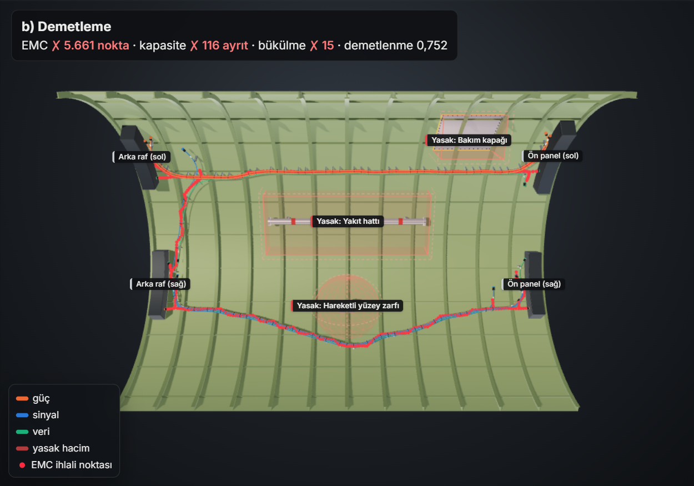 |
| **c) EMC duyarlı demetleme** | **d) Lagrange gevşetmesi** |
| 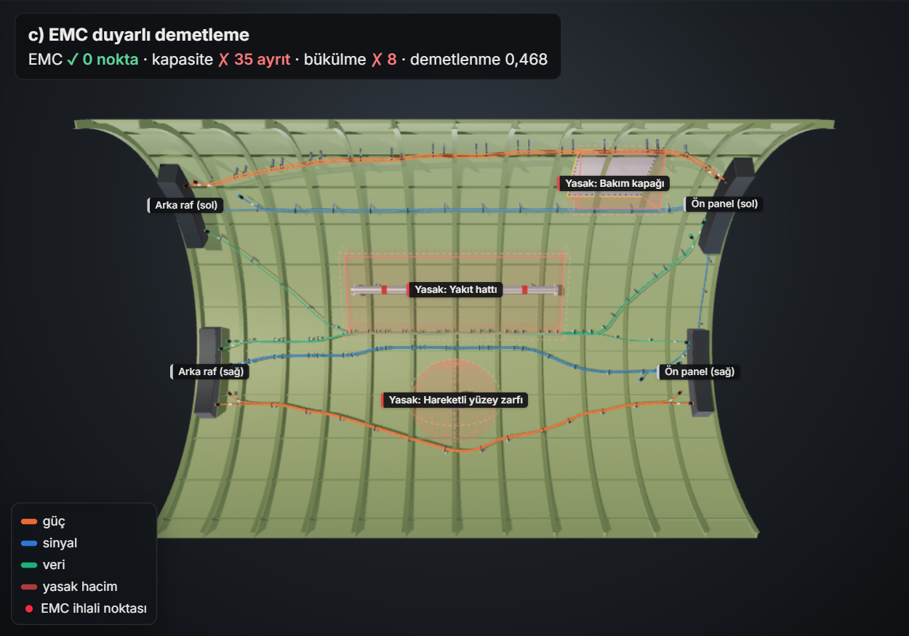 | 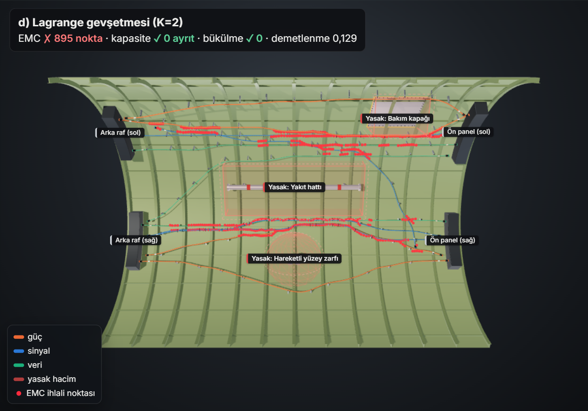 |
| **e) Bütünleşik** | **f) Dallı demet** |
| 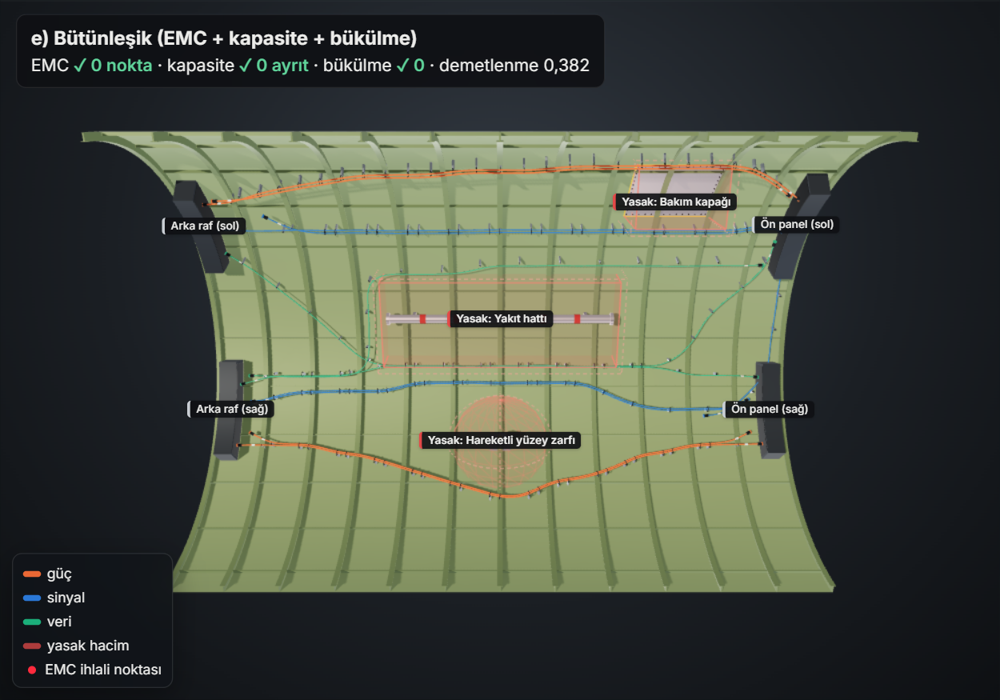 | 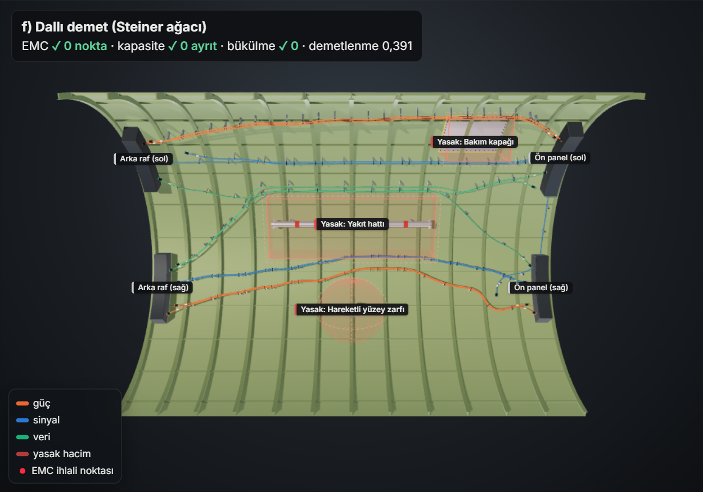 |


Tüm görseller aynı kameradan, gövdeye alttan bakılarak etkileşimli sayfadan yakalanmıştır
([`docs/index.html`](docs/index.html), altı yöntem tek sayfada). Görsellerde demet ekseni yüzeyden ~10 cm
kaldırılır, aynı güzergâhı paylaşan kablolar demet içinde yan yana dizilir ve köşeler yumuşatılır; bunlar
yalnızca görseldir, denetimlere ve metriklere girmez. Frame, stringer, kelepçe, konnektör ve ekipman rafları
da görseldir.

## Asıl projede nasıl genişletilir

- **Kapasiteli Steiner ormanı:** f) yöntemi Steiner ağaçlarını sezgisel bir koridor olarak kullanır. Asıl modelde
  her ayrıt bir kez "açılır" (kanal/destek maliyeti) ve üzerinden geçen kablolar kapasiteyle sınırlanır. Bu,
  demetlemeyi sezgisel indirim yerine doğrudan amaç fonksiyonunda temsil eder. Lagrange gevşetmesiyle alt
  problemler yine en kısa yol / Steiner ağacı problemlerine ayrışır; bu alt problemler bükülmeyi bilen dönüş
  çizgesi üzerinde çözülebilir.
- **EMC'nin Lagrange çerçevesine katılması:** Bütünleşik yöntemdeki EMC cezası, ayrım kısıtları
  için ayrı çarpanlarla gevşetilerek sezgisel ceza yerine alt sınır üreten bir modele dönüştürülebilir.
- **Düğüm seçim maliyeti:** Dallanma noktaları, geçiş delikleri ve bağlantı noktaları için
  düğüm maliyetleri; demet ayrılma/birleşme noktalarının sayısının kontrolü.
- **Ekranlama aktif bir rotalama değişkeni olarak:** Ekranlı/ekransız seçim, ayrım mesafesi
  gereksinimini değiştiren ve maliyeti/ağırlığı olan bir karar değişkeni olarak modele girer.
- **Kelepçe aralığı:** Güzergâh boyunca destek noktalarının izin verilen aralıkta
  yerleştirilebilmesi; uygun yapısal bağlantı noktalarına yakınlık.
- **Kablo sırası:** Sağlamlık testi, sıralı yöntemlerin sıraya duyarlılığını ölçer; `--order` ile denenen basit
  sıralama sezgiselleri bu senaryoda varsayılan sıradan iyi sonuç vermemiştir. Asıl projede tamamen eşzamanlı
  (Lagrange tabanlı) yöntemler bu bağımlılığı azaltabilir.
- **Mesh'ten bağımsız bükülme ölçütü:** Yakınsama çalışmasının gösterdiği gibi üç köşe çember yarıçapı ölçütü kaba
  mesh'te keskin kırılmalara göz yumar. Bükülme, sabit bir yay uzunluğu boyunca dönüş açısıyla (ya da yumuşatılmış
  eğri üzerinde) ölçülmeli; dönüş çizgesi de buna göre birden fazla ayrıtlık geçmişi tutmalıdır.
- **Gerçek geometri ve CAD'e aktarım:** STL/OBJ/PLY yüzeyleri artık okunabilir ve `routes.json` 3B kırık
  çizgileri, `harness_developed.dxf` gerçek uzunluklu açınımı verir. Sıradaki adımlar: postalar, kirişler ve
  zorunlu kelepçe noktaları gibi yapısal kısıtlar; demetin KBL/VEC gibi kablo demeti değişim biçimlerine
  aktarılması (bu biçimler topoloji, konnektör ve parça bilgisi ister; bu demoda yoktur); formboard için dallanma
  noktalarının düzleme yeniden yerleştirilmesi.

## Lisans

[MIT](LICENSE). Gömülü üçüncü taraf bileşenler kendi lisanslarını korur: three.js (MIT) ve Inter yazı tipi
(SIL Open Font License 1.1, [`vendor/fonts/LICENSE`](harness_demo/viewer/vendor/fonts/LICENSE)).

---

Geliştirmede yapay zekâ destekli araçlar kullanılmıştır; tasarım kararları ve doğrulama ekibimize aittir.
